# Development acceptance and timing evidence — 2026-11-17

## Verified V2 singleton on 2026-11-18

[Sandbox #24](https://github.com/alexmakeev/jam-bot-sandbox/issues/24) completed from attributed approval through closure under observation. The receiver ran image `sha256:327dcf85f8f3051f38900ab8193917a3b1e3a1b6a672db28e88a3a309551a452` with the verified Test/Sandbox opt-in. RED was assertion-based on `0c689eb0d2581173a13428f02574845a3270d8e3`. The independent consultations, mandatory reviews, combined checks and verified publication used the GREEN revision `96115f142638ea503e642e5f4de22847067f3997`. [PR #25](https://github.com/alexmakeev/jam-bot-sandbox/pull/25) merged that revision into dev. Closure and worktree cleanup receipts are retained under batch `1928b34e-39b8-4e4e-8b4d-2fac52b4b101`.

The deployed V2 route used stage-isolated workspace leads. The two-member shared-lead diagnostic independently confirmed authenticated access across revisions and a denied read after retirement. The success of the shared diagnostic establishes capability for an isolated fixture. Live dependency, grouped integration and restart acceptance have separate evidence.

## Verified singleton outcome

[Sandbox work card](https://github.com/alexmakeev/jam-bot-sandbox/issues/16) completed from its owner-authorized creation through architecture, both configured architecture consultations, attached specification, TDD, both implementation consultations, mandatory review, branch validation, integration acceptance, a merged PR into `dev`, final report and issue closure.

- Created: 2026-11-17 18:35:51 UTC.
- [Integration PR](https://github.com/alexmakeev/jam-bot-sandbox/pull/17) merged: 19:05:47 UTC.
- Issue closed: 19:05:55 UTC, after the merge.
- Tested and published revision: `9f7e81eeb6b69a99802bd94135486d2107c34df0`.
- Elapsed wall time: **30 minutes 4 seconds**.
- Original intake and worker receipts are retained. The work card has no operator resolutions or integration retry records. The operator performed read-only observations after creating this card; no service changes, restarts, task edits, hints or manual advancement occurred during its execution.
- GREEN and combined acceptance: 34 unit tests passed. The integrator's isolated Chromium recipe passed the existing sum-page checks at 320, 640 and 1280 pixels on the exact candidate. Production deployment is a separate lifecycle step.
- Earlier cards 13 and 14 are not clean acceptance evidence: card 13 was withdrawn before execution during stand preparation; card 14 exposed publication convergence failure and completed after a shared service fix.

This establishes one clean singleton run in the configured Development pilot. It does not establish universal task success, live multi-card batch acceptance, or a clean deliberately interrupted recovery run. Existing test coverage and earlier repaired runs must remain distinguishable from those live acceptance cases.

## Reconstructed critical path

Consultant timestamps are explicit `startedAt` / `finishedAt` receipts. Native role durations use the stored attempt start and the final checkpoint modification time, so they approximate dispatch-to-verified-receipt latency rather than provider inference time. Figures are rounded and intervals overlap where calls run in parallel.

| Activity | Observed duration | Interpretation |
| --- | --- | --- |
| Architecture Antigravity consultation | 7m 52s | Codex ran concurrently and finished in 16s. The phase waited for Antigravity. |
| Implementation Antigravity consultation | 7m 21s | Codex ran concurrently and finished in 15s. |
| Separate mandatory implementation reviewer | 4m 02s | Additional native model review after both external consultations. |
| Integrator decision | 2m 08s | Candidate approval after combined tests; publication follows. |
| Other native work products | About 5m 36s | Draft architecture 35s, final specification 1m 24s, worker preparation 1m 03s, RED test authoring 1m 19s, implementation 1m 15s. |
| Remaining elapsed time | About 3m 05s | Intake, checkout, process and container startup, test execution, attachment verification, branch validation and publication/closure. |

The two slow consultant calls account for about **51%** of elapsed time. The separate mandatory implementation reviewer and integrator decision account for another **20%**. Unit execution itself reported about **0.3 seconds per full suite**; it does not explain the half-hour result. End-to-end test-job time also includes process/container setup and, at integration, browser checks.

```mermaid
flowchart LR
    A[Approved Task] --> B[Draft architecture]
    B --> C[Parallel Codex and Antigravity reviews]
    C --> D[Final specification]
    D --> E[Baseline → RED → implementation → GREEN]
    E --> F[Parallel implementation consultations]
    F --> G[Mandatory native reviewer]
    G --> H[Branch and combined acceptance]
    H --> I[Integrator decision]
    I --> J[PR → confirmed dev revision → issue closure]
```

## Existing observability and its limits

The service already retains consultant start/finish times, role attempt starts, receipts, integration checkpoints and GitHub event times. These are sufficient for this reconstruction. There is no unified per-card performance report, consistently explicit native-role end timestamp, aggregated token/cost accounting, or provider-side breakdown of queueing, authentication, generation and output buffering.

The consultant host heartbeat proves that the host is maintaining the request. It does not prove provider generation progress. The Antigravity text-output adapter may produce no stdout until the final answer; zero output bytes alone cannot distinguish provider queueing from reasoning or buffering. Container CPU/network observations likewise do not identify the remote model's internal stage.

Each native work-product call resumes a lead CLI session and asks it to dispatch a named teammate. This adds orchestration and context-processing work. Its separate latency and token overhead have not yet been measured, so it is a suspected optimization target rather than an established root cause.

## Proposed next improvements, not implemented

1. Add a thin structured span record per operation: issue, role, phase, provider/model, attempt, start/end, outcome and elapsed time. Keep prompts, outputs and secrets out of these timing records. Generate a local/read-only management summary; do not update GitHub on each timer tick.
2. Measure request submission, first response byte and completion where the provider interface exposes them; label unavailable measurements honestly. Distinguish host liveness from provider progress.
3. Review the additional mandatory implementation model pass. Both independent consultants already inspect the green implementation. A profile could use structured consultant verdicts and deterministic handoff gates, requesting another model decision only for actionable findings or ambiguity. This changes profile policy and requires an explicit decision; it was not changed during acceptance.
4. Measure lead-session resume, teammate dispatch and context/token usage before changing harness behavior. Preserve teammate identity, recovery and refusal handling.
5. Keep consultant/model selection and any future small-task recipe in the planned Development profile boundary. Do not silently remove the required consultations to improve a benchmark.

No performance optimization was applied to the clean run. The installed publication fix uses bounded read-only PR convergence checks and fresh read-only reconciliation of an already-published candidate; it does not repeat publication to resolve an old cached failure.

## Subsequent consultant runtime audit

Read-only inspection of the two retained Antigravity CLI logs and their conversation databases established the following for this card:

- Each consultation created a fresh conversation, forwarded one user message and retained one generation record. Each database contains two completed steps, no subtrajectory flags and no parent references. There are no tool-execution steps in those retained trajectories.
- Architecture startup and silent authentication completed within approximately four seconds; the user message was forwarded at 18:37:23 UTC and the stream stopped at 18:45:11 UTC. Implementation forwarded at 18:51:15 UTC and stopped at 18:58:31 UTC. The dominant elapsed interval is after submission, not local initialization.
- The startup warning about not yet being logged in is followed by successful silent authentication in about 1.5 seconds. It is not evidence that the entire call spent minutes re-authenticating.
- Logs contain repeated failed telemetry posts to `play.googleapis.com`, which the restricted proxy denies. These appear as 94 client error entries for architecture and 87 for implementation, each also mirrored by the telemetry logger. They are not 94/87 model generations. The architecture log also contains a burst of skipped temporary-file watcher entries during shutdown. Their causal contribution to latency is not established.
- The application supplied a phase-specific read-only review instruction, a request for at most three actionable findings within 350 words, and a bounded JSON evidence packet. The actual retained input was about 7,267 bytes for architecture and 50,854 bytes for implementation. This was a task-specific packet, not the human chat history.
- Architecture packet field sizes: project values 223 bytes, requirements 1,883, architect draft 3,940, repository evidence 822. Implementation: specification 7,513, diff 3,509, current test report 5,447, repository evidence 9,723, TDD evidence 19,507, plus small identity, requirement and handoff fields. TDD and test evidence dominate input volume. Sizes are bytes, not token counts.
- These records do not reveal provider-side queueing versus inference duration. No private model reasoning was needed for this operational audit.

The Codex adapter independently starts one ephemeral, read-only CLI call per phase, disables tool execution and multi-agent features, and supplies the same bounded review packet with its own concise review instruction. The retained provider receipts show one successful reply per phase without selective retries. Its exact effective model and full call durations are recorded, but an equivalent detailed per-call native trace was not retained: the consultant uses ephemeral mode, its persisted log database is empty, and no matching session transcripts were found in its dedicated volume. Therefore the Antigravity startup measurements must not be attributed to Codex. A future audit can retain sanitized lifecycle/tool-event and usage metadata without persisting credentials, prompts or private reasoning.

## Same-prompt Carbon diagnostic repeats

The owner authorized isolated repeats of the original implementation consultation, including a lower-effort comparison. The input was reconstructed from the retained user-input step only. Both successful repeats used identical 50,854-byte prompts with SHA-256 `46c09170d38fbc959ba563fef4ceebb2d02b9b72402c62ece94f02d1a8727aa1`, the same pinned CLI image, tool restrictions and credentials, and streaming JSON output for lifecycle measurement. Project settings and work cards were not changed.

| Effective variant, confirmed by CLI log | Wall time | Outcome |
| --- | --- | --- |
| Gemini 4 Carbon (High) | 283.813 seconds (4m 44s) | Exit 0; one successful repeat. Initial lifecycle event appeared after about four seconds. |
| Gemini 4 Carbon (Low) | 15.433 seconds | SUCCESS, exit 0, one turn; 25,957 input tokens, 588 output tokens and zero thinking tokens reported by the CLI. |

This pair differs by about 18.4 times in wall time. It is a single observation per variant, not a controlled benchmark or a review-quality comparison. The valid Low repeat started after High completed while the CLI argument semantics were being clarified, so these successful calls were not a simultaneous pair. The original High implementation call took 7m 21s, also showing material variability between runs.

An earlier attempt combining `--model gemini-4-carbon-high` with `--effort low` failed in about four seconds with an explicit configuration conflict. It performed no model generation and is excluded from timing comparisons. The actual Low repeat used only `--model gemini-4-carbon-low`.

The [official effort documentation](https://antigravity.google/docs/cli/commands/effort) describes effort as selection of a model-family reasoning variant. The [headless documentation](https://antigravity.google/docs/cli/headless/) lists the explicit variant slugs. A separate read-only configuration probe using the base family `gemini-4-carbon` and `--effort low` returned `low` with zero generation tokens. Thus either an explicit variant or a base family plus effort can express the selection; contradictory explicit values must fail rather than silently override one another. Supplying Low twice is unnecessary. Technical event reports retained locally exclude prompts, credentials and private reasoning.

## Candidate Development capability checks after the singleton run

These checks do not replace a clean end-to-end Task run. The already recorded singleton acceptance remains the evidence for the earlier installed build.

- Isolated native architect, Codex Sol Low and Antigravity Argon Low calls independently discovered a value stored in a repository file but omitted from the prompt. The native architect took about 14 seconds, Codex about 15 seconds and Argon about 30 seconds in these individual capability probes.
- The workspace protocol exposes exactly three read-only tools. Automated checks deny protected paths, traversal and writes, cover byte-range reads and within-file search pagination, and retain exact Git blobs despite archive export attributes.
- The local specification index distinguishes pending work, worker-complete heads awaiting integration, published originals/corrections and confirmed integrated work. Document digests and publication receipts are checked; specs remain outside disposable worktrees.
- A real pinned quality container completed baseline GREEN, assertion-only RED and implementation GREEN. Separate tests reject mixed assertion/import/syntax failures and forged receipt text emitted by test code. Real HTML, embedded JavaScript and CSS parser checks passed.
- Test/Sandbox fixture maintenance branches passed the stronger static checks, unit suites and current integrator Chromium acceptance. Independent consultants found no material behavior regression. The preparation PRs were fast-forwarded into dev and their merged GitHub state verified. This operator preparation is not an autonomy acceptance run.
- Cleaner tests verify closure and head ownership, preserve uncommitted work and shared/protected resources, retain manifests/recovery evidence, measure logical file bytes separately from observed filesystem free-space change and replay without another deletion.
- Management diagnostics tests cover bounded drill-down and exclusion of prompts, private role outputs, terminal records and credential stores. Public-endpoint verification and live rollout remain to be completed.

The candidate is opt-in for Test and Sandbox; unrelated installed topics retain their prior Development recipe. Own-repository dogfooding is not enabled by these checks.

The complete candidate regression suite passed 103 TypeScript/service tests and 51 host-script tests before installation. These counts include the workspace protocol, cached-receipt inspection checks, role refusal preservation across changed inputs, quality evidence, diagnostic drill-down and Cleaner ownership/replay checks.

## Readiness hardening before the Test/Sandbox rollout

Independent source review identified recovery and evidence gaps in the initial candidate. The follow-up now binds direct repository and specification-index reads to each named consultant and both pinned workspace identities; unpublished specification receipts remain pending until local remote-verification proof is durable. Stable stage checkpoints preserve original inputs and refusals across restart.

RED evidence now identifies the exact baseline-production/candidate-test composite tree, including removed tests. Skipped/TODO cases cannot establish GREEN. A recovered RED stage revalidates its original baseline before implementation. Cleaner writes immutable intent and per-resource receipts; interrupted deletion preserves its measured inventory and explicitly uncertain attribution. Read-only host validation may recover once without repeating model calls; staged recovery intent consumes that budget.

Diagnostics expose only confirmed published report bodies, explicitly project inspection metadata, paginate native and consultant records together, and enforce a serialized response byte budget. Local tests cover unpublished report rejection, bounded consultant pagination and exclusion of unknown trace fields. The follow-up regression suite passed 112 service tests and 55 host-script tests; the added staged-intent recovery test also passed. A real container probe passed baseline GREEN, assertion-only RED and implementation GREEN with exact execution bindings. Rollout and fresh autonomy acceptance are still pending at this checkpoint.

Final isolated image checks: native architect Medium independently read the specification index and source in 17 seconds; Sol Low and Argon Low both discovered fixture data absent from the prompt through audited direct reads. A preceding native probe used search-only source inspection and was correctly rejected; the role instruction now explicitly requires direct source/index reads. The final service image is `sha256:692c19d5c85702d9d541c88cbe70b10edfc06885ed2fe1499af4ae54e14dde95`; the matching consultant workspace image is `sha256:2a942473e03f999820c3ab3e9eb26ece104964a03302352816f6a535c72bb6d3`. Final automated totals are 112 service tests and 56 host-script tests.

## Installed candidate and fresh acceptance card

The hardened candidate was installed for Test and Sandbox only. The receiver reports healthy on the exact image above. Public HTTPS REST diagnostics returned 401 without an owner credential and 200 with it; the public `/mcp` endpoint also served the new bounded diagnostics operation. Vsemu remains outside the opt-in repository list and its project configuration was preserved. Private rollback copies are retained on the host; no credential contents are included here.

Fresh autonomous acceptance is running as [Sandbox #19](https://github.com/alexmakeev/jam-bot-sandbox/issues/19), adding `sumNegative` with assertion-based test-first evidence while preserving the existing UI. Task creation used the verified delegated human identity `alexmakeev`. After intake, observation is read-only; this checkpoint does not claim a completed run. Test #35 remains at its original refusal/review boundary and was not retried.

Sandbox #19 stopped at the first architect stage: its native work product explicitly reported that only SendMessage was available, so it could not independently inspect the pinned code/index. The read-evidence gate rejected the result; the original issue received a responsible-human mention and Markdown incident. The Task remains open in review and was not retried or manually advanced. This run does not establish autonomy.

A disposable no-MCP-role → workspace-role fixture reproduces the missing-tool condition. Metadata instrumentation confirms the workspace MCP server advertises its three tools before Agent dispatch, but the teammate receives no usable workspace tools. CLI configuration experiments remain isolated and uninstalled; no provider refusal was retried or rerouted. Current work is to resolve this concrete native-harness tool propagation boundary before another fresh acceptance card. Retained image tags and local image-existence checks now protect the two test recipes against moving development build tags.

## Native tool-context and refusal hardening follow-up

A disposable stage using a distinct workspace role and a server-scoped tool filter independently discovered a hidden fixture value in 17 seconds. Its reported tool inventory contained exactly SendMessage and the three workspace operations. Repeated-stage fixtures exposed sensitivity to the prior native session's tool context; the candidate now binds each workspace attempt to its own durable challenge-derived native session while preserving the coordinator and original refusal records.

The subsequent multi-stage fixture stopped before reaching its workspace stages: Claude returned a normal `stop_reason: refusal` without the previously expected API-error flag, and the CLI automatically switched models. The fixture was stopped, retained and not retried. This is not accepted work or autonomy evidence. The candidate disables automatic model switching and recognizes normal refusals and fallback metadata, checks the full recorded metadata stream rather than only its tail, and rejects live or cached fallback receipts. Regression tests cover these paths without invoking another model. The existing Test #35 and Sandbox #19 cards remain paused; any next acceptance attempt must use a fresh, independently authorized work card.

## Installed follow-up and explicit queue hold

Commit `af4645c` is installed on the two opted-in test topics: receiver `sha256:f63c5e46f6a4ed367b4f9eda69d2a52f45bb5aceb9c31c8ee3869fdf9c06277a`, consultant workspace `sha256:7a0dd3efd66035d77ee9b409544d22a123347e6315aae94a4a8fb4d61542a8bf`. Immutable local tags retain both images. The complete automated suites pass 116 service tests and 56 host-script tests. One timing-sensitive fixture returned an uncertain worker observation in an earlier run; its isolated rerun and the subsequent complete suite passed without weakening the fail-closed ownership check.

Fresh [Sandbox #20](https://github.com/alexmakeev/jam-bot-sandbox/issues/20) requests sumSquares, independently of the held sumNegative card. It has not entered execution: the journal deliberately blocks intake and new workers while any issue awaits manual review. Sandbox #19 is that barrier; its worktree is clean at baseline `b7fa76a`, with no implementation commits. Test #35 remains held separately. No review state was cleared and no work card was advanced. A diagnostic follow-up exposes the recorded barrier and blocking issue numbers explicitly. Continuing on the current Sandbox requires a human disposition for #19; a completed new autonomous run, grouped integration, interrupted-run recovery and own-repository onboarding remain unproven.
