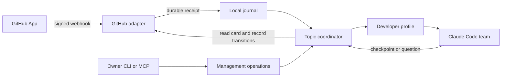

# TypeScript architecture

Design for the [first recovery experiment](https://github.com/alexmakeev/jam-bot/issues/1). The [PRD](PRD.md) owns product requirements. This specification describes the target boundaries and the evidence needed to implement them. A passing fixture demonstrates only the behavior exercised by that fixture.

## One service, one owner per repository

Run one Node.js service with a TypeScript core on the owning machine. A topic binds the project URI, environment and concrete work profile. Keep the coordinator, worktrees and team for that repository on the same machine. A machine can own several repositories. Start with ordinary modules in one package. Introduce interfaces where external I/O needs replacing in the experiment.



| Module | Responsibility | State it owns |
| --- | --- | --- |
| GitHub adapter | Verify webhook signatures, identify the installation, normalize relevant changes, reread remote cards and write authorized updates. Inspect actual approval provenance. | Mapping between GitHub resources and project references. Cards, discussions, attached specs and remote branches live on GitHub. |
| Topic coordinator | Serialize decisions per work card, enforce admission and ownership, reconcile visible state and dispatch a work assignment. | Local coordination state and outstanding deliveries. |
| Operational journal | Record received deliveries before acknowledging them, intended effects before execution and their observed outcomes. SQLite is a candidate for the service. | Local receipts, attempt identities and reconciliation cursors. |
| Developer profile and harness | Assemble instructions, model, command, tools and credential references. Let JAM coordinate architect, developer and integrator roles. Bind each assignment to a worktree. | Session handles and worktree state; in-flight conversation is expendable. |
| Management | Share application operations between REST with OpenAPI, CLI and authenticated operator MCP. Check the target instance and topic before mutation. | Server-owned profile configuration, routing and access policy. |

## Source boundary

A webhook is a hint to re-read a specific resource. Preserve issue, review and branch-update distinctions. The adapter owns signature verification, pagination, label semantics, account identity and attachment handling. Keep remote references opaque outside it. Approval evidence must bind a trusted person to the agreed scope and revision, including approval via an authenticated maintainer conversation. A bot-authored assertion alone cannot establish this.

A minimal TypeScript boundary for recovery could look like this. Names are illustrative. An implementation should introduce each operation when its first caller exists.

```ts
type CardRef = { projectUri: string; cardUri: string };
type Checkpoint = { phase: string; summary: string; codeRevision?: string };
type Assignment = { id: string; card: CardRef; worktree: string };

interface ProjectSource {
  readCard(card: CardRef): Promise<CardSnapshot>;
  recordTransition(card: CardRef, change: CardTransition): Promise<WriteOutcome>;
}

interface Harness {
  inspect(assignment: Assignment): Promise<'active' | 'absent' | 'unknown'>;
  start(assignment: Assignment, checkpoint?: Checkpoint): Promise<void>;
}
```

A card snapshot includes verified approval, the current spec reference, dependencies, waiting request and shared handoff. A card transition carries an operation ID and expected prior state. The source reports an applied, previously applied, conflicting or uncertain write. Reconcile uncertain writes by reading the remote record. Avoid promising conditional writes that the provider cannot enforce.

GitHub is the first adapter. A future GitLab adapter would own its authentication, webhook payloads, issue references and merge request semantics. Add a second adapter when its workflow and permissions can be tested. Keep Git operations on the worktree independent of provider event parsing. A new consultant or role is a profile change when existing operations suffice.

## Recovery and exclusion

1. Verify the webhook and durably record its delivery before acknowledging acceptance. Startup also reconciles accessible repositories, failed deliveries and current card state.
2. Verify topic ownership and current approval. Reports, revoked access and unresolved dependencies cannot start a developer. Record a stable assignment identity before attempting a launch.
3. Inspect the existing assignment using that identity. If active, reconnect. If absent, compare the card, checkpoint, worktree and branch, then resume the unfinished step. If observation is uncertain, defer spawning and reconcile. A PID alone cannot identify a worker after restart.
4. A crash after an external effect and before local acknowledgment requires observing that effect before retry. For a question, persist its correlation identity and waiting reason, then notify the recipient. Repair derived labels from the reconciled record. A repeated delivery may have a different delivery ID from another event describing the same change.
5. A local claim protects a single host only. For the first deployment, assign disjoint repositories to named machines. Before enabling reassignment, require evidence the old owner can no longer mutate GitHub or start work. Warn on conflicting ownership and halt the contender. Timeout or silence alone is insufficient to take ownership. Cross-host exclusion remains an explicit test gate.

For an in-process Claude team, apply exclusive local ownership to the lead session. The planned service wrapper holds that claim while launching or resuming the lead; an assignment carries the native teammate handle. Reach the teammate through that lead. A fresh response can demonstrate logical resumption even when the original OS process died. The live experiment below is single-operator and does not implement concurrent lead-session ownership.

Local checkpoints and logs belong in a Git-ignored directory inside each feature worktree. Recovery reads them with the diff and current files. Routine progress writes stay local. After a verified integration into shared dev, stop the included workers and remove their worktree directories and scratch logs. Preserve any worktree with unintegrated changes, including unrelated untracked files. Retrying cleanup skips worktrees already retired. Close the corresponding work cards after verified integration. For issue events, inspect only the referenced card and check its current open state before scheduling. A comment on a closed card cannot enqueue a worker. On restart, page through open work cards and reconcile known active or unfinished assignments by reference. Reopening a card triggers the usual admission checks. Acceptance: adding 10,000 closed issues leaves the number of source reads for one incoming issue event unchanged.

## Developer and operator boundaries

Codex in maintainer mode reads code, discusses in the user's language and writes English work cards through scoped issue access. Its workspace and credentials must enforce the code-write restriction. Protect service credentials and neighboring worktrees from code and tests run by a developer. The role instructions communicate policy; tool authorization enforces it.

The profile owns TDD, consultants and release policy. Run configured consultants in parallel on a prepared spec, requirements and diff, or failure evidence as appropriate. Preserve the exact combined test revision, environment and runnable test results. Return a fix request and attached Markdown spec to the originating card. Rebuild and retest after a fix. Serialize branch promotion against its expected head. Stable promotion requires explicit maintainer approval of that revision. Required attachments, real unattended teammates, credential isolation and cross-host ownership each need their own integration check.

## Per-topic integration queue

The three work-card routes share admission checks. JAM sends an approved assignment to its owner and an approved consultation to its specialist. Only development emits a ready feature branch for integration. GitHub labels project the trusted class and current progress. The dispatcher chooses a repository-scoped profile after verifying human authorization.

Persist each ready issue, branch and immutable head in the topic journal. A newer ready head supersedes the queued head for the same issue and keeps its waiting time. JAM can vary batch size within JB-20. The default target is ten. A short delay for an undersized group requires a known completion estimate within sixty seconds of the oldest ready entry. With no such signal, claim immediately. A single transaction allocates the batch ID and marks its revisions. The oldest waiting entries are served first.

A snapshot lists waiting revisions and the active batch. Recovery reconciles that same batch ID and exact revisions with candidate artifacts and the integration ref before taking action. Complete verified promotion against the expected base. A failed candidate retains its original membership. After diagnosis, release explicitly unaffected heads for another batch. A corrected revision supersedes an affected head. Ambiguous external effects keep the batch active pending reconciliation.

## First experiment

Use an isolated workspace, one approved sample card and a controllable child process. Inject failures before launch, after launch and after checkpoint persistence. Replay input and restart the supervisor both while the worker is alive and after it exits. Observe one live assignment, the same worktree, continuation from the saved checkpoint and no duplicate logical effect. Also exercise unapproved input and an ambiguous live-worker observation. Document which cases have actually run.

Run a separate Claude Code experiment with the configured developer profile. Verify a real teammate in its assigned worktree, delegation to a short-lived subagent, unattended question delivery and recovery of the task when the original session is gone. Track fixture and real-harness evidence separately. Confirm multi-repository isolation and zombie-host rejection before deploying on any shared server.
