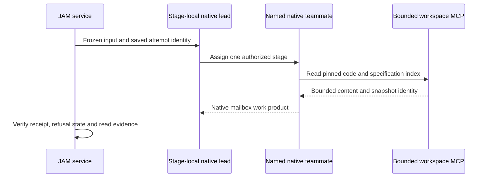

# Independent consultant runtimes

The host publisher reads the optional `consultants` array from each repository entry in its private catalog. A development Task supplies its verified approval, phase and bounded evidence. The host rechecks the original issue and both human identities. Architecture, implementation and diagnosis consultations send their packet to every configured provider concurrently and return one result per configured name. An empty array returns immediately. Provider credentials remain on dedicated Docker volumes. A consultation container receives its packet on standard input. The legacy packet-only mode has no repository checkout. The opt-in workspace mode mounts a pinned read-only repository and approved specification index through three bounded read-only MCP tools; neither mode receives the host home, Docker socket or GitHub credential.

## Connect Codex

Build the CLI image, create a dedicated authentication volume, and start the official device login. Enter the code from the terminal in the official OpenAI browser page. A new container using this volume can verify the login after the first container exits.

```sh
docker build -t jam-codex-consultant:0.169.0 scripts/consultants/codex
docker volume create jam-codex-consultant-home
docker run --rm -it --mount type=volume,src=jam-codex-consultant-home,dst=/home/jam/.codex jam-codex-consultant:0.169.0 login --device-auth
docker run --rm --mount type=volume,src=jam-codex-consultant-home,dst=/home/jam/.codex jam-codex-consultant:0.169.0 login status
docker image inspect --format '{{.Id}}' jam-codex-consultant:0.169.0
```

Copy the image ID printed in the last command into the repository's private publisher entry. Add the following array alongside its existing test recipe and image. Replace the example digest with that exact ID.

```json
{
  "consultants": [
    {
      "name": "Codex",
      "provider": "codex",
      "image": "sha256:<64 hexadecimal characters>",
      "volume": "jam-codex-consultant-home"
    }
  ]
}
```

Set an optional provider `model` or a per-profile `timeoutMinutes` from 1 to 30. The host defaults to a 30-minute ceiling. Failure records identify the provider and return a limited diagnostic. A retry may select only the named providers that failed; successful responses remain available. The Mac publisher scans other work while reviews are in flight. Install the [Antigravity runtime](../scripts/antigravity/README.md) separately when adding that provider. An explicit model such as `gemini-4-carbon-high` is retained with its response. Install updated broker scripts with the existing publisher installer. The legacy CLI receives an empty workspace in a read-only image containing only its static binary and CA certificate bundle. Shell, remote apps, plugins, filesystem execution and web search tools are disabled for reviews. See the [official OpenAI authentication guide](https://developers.openai.com/codex/auth/).

An optional `effort` explicitly selects supported reasoning depth. Codex receives it as `model_reasoning_effort`; Antigravity receives `--effort`. An Antigravity variant already containing an effort suffix, such as `gemini-4-argon-low`, does not need the extra field. Contradictory suffix/effort choices fail before dispatch. Configured effort is retained in the consultation receipt. The Test and Sandbox operator profiles now explicitly select `gpt-6.2-sol` with `effort: low`, and `gemini-4-argon-low`; these exact versions were checked against the available catalogs and through live synthetic calls. Automatic latest-family resolution and management editing remain unimplemented requirements under JB-42. Repository-reading access uses a separate opt-in workspace capability; setting a model or lowering effort does not grant tools.

## Independent workspace capability

Build `scripts/consultants/Dockerfile.workspace` from the pinned service workspace image and the pinned Codex/Antigravity CLI images. Codex also needs its matching `codex-code-mode-host` executable; disabling that host disables its MCP tools. Shell, execution, browser, apps, plugins and subagent tools remain disabled. The workspace MCP advertises read-only annotations and only its three named tools are permitted. Antigravity receives a trusted workspace MCP configuration with eager schemas and exact read-tool permission rules, using its documented [workspace configuration](https://antigravity.google/docs/mcp?tab=cli). Codex uses scoped [MCP approval settings](https://learn.chatgpt.com/docs/extend/mcp?surface=cli) for these read-only tools.

A successful workspace consultation requires recorded repository reads and a read of `specifications/index.json`. Native architect, worker, mandatory reviewer and integrator stages use the same capability and verification. Per-stage audit metadata persists through receipt recovery; external inspection metadata is copied into the durable broker ledger and phase record before the temporary exchange is removed. Prompts and file bodies are not part of the read audit. Local approved specs remain outside task worktrees and survive Cleaner.

Live isolated probes verified independent file discovery by the native architect (about 14 seconds), Codex Sol Low (about 15 seconds), and Antigravity Argon Low (about 30 seconds). These are capability checks, not full autonomy acceptance or stable latency guarantees.

The Codex image Dockerfile now preserves the matching code-mode host alongside the CLI, so the workspace image can copy both from a fresh pinned CLI build without depending on a historical local image.

## Native workspace stage isolation

The pinned native adapter uses a separate `jam-<role>-workspace-v1` definition for workspace-enabled stages. Its tool list permits `SendMessage` and the `jam_workspace` server, whose protocol tests require exactly the three read-only operations above. Literal per-tool filters were not reliable in the retained Claude Code 2.1.325 in-process regression; a server-scoped filter produced the expected four-tool inventory without Agent, shell, ordinary filesystem tools, or unrelated MCP tools. Both the server configuration and tool metadata request upfront loading. Tool-list and rejected-call audit records contain metadata only.

Each workspace-enabled attempt uses its already-persisted challenge UUID as its native session ID. An existing stage session resumes; a new one starts without inheriting the coordinator's former tool context. The coordinator journal and authorization remain unchanged. Recovery checks that exact stage session and retained legacy receipts before considering replacement; ambiguous receipts stop execution. Non-workspace roles retain their original tool restriction.



This agent-side MCP capability is separate from owner management REST/MCP. It does not grant management access or credentials.

The adapter sets `switchModelsOnFlag: false` and treats both normal API refusal stops and `model_refusal_fallback` metadata as blocking. It checks before accepting live or cached role/review receipts, including a refusal preceding a large transcript tail. No fallback work product grants authority to continue. The [official model configuration documentation](https://code.claude.com/docs/en/model-config#ask-before-switching) describes the switch setting; the [MCP documentation](https://code.claude.com/docs/en/mcp#exempt-a-server-from-deferral) describes upfront tool loading.

`test/native-workspace.integration.mjs` is an explicit live capability probe, excluded from the default unit suites because it requires the native harness and its credentials. It exercises a prior non-workspace stage, two different code snapshots, exact tool inventory and a denied synthetic protected-file read. Run it only in an authorized disposable service-image environment. A provider refusal ends the probe; do not change models or retry its refused payload. Its latest multi-stage invocation stopped at a provider refusal before the workspace stages, so it does not establish multi-stage acceptance.
