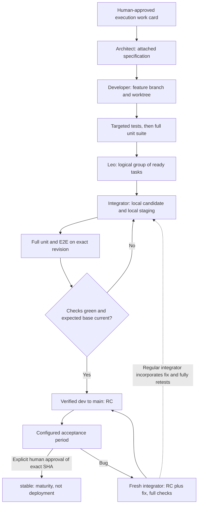
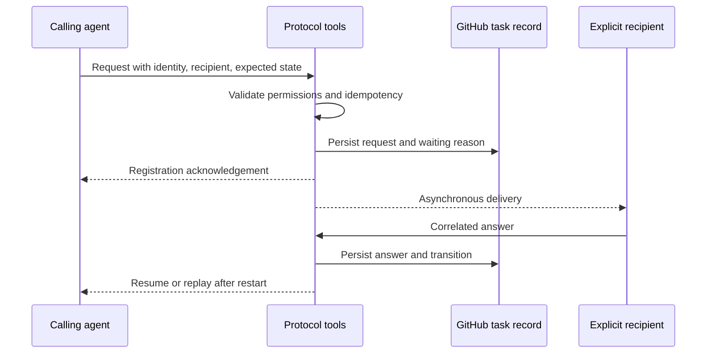
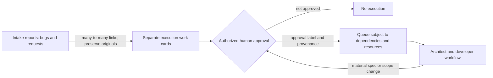
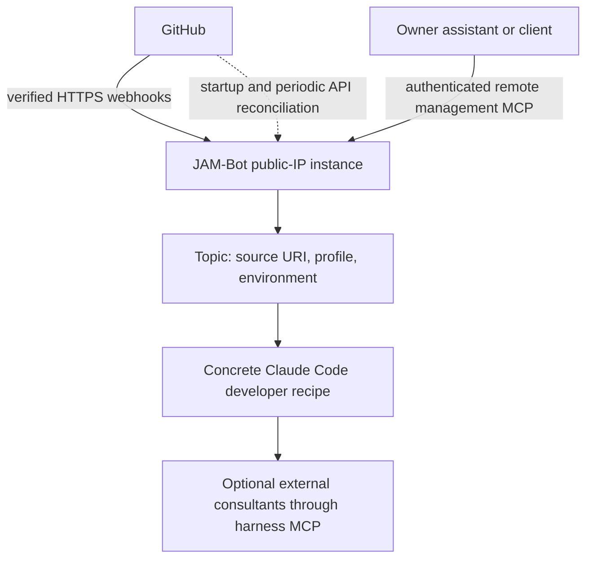

# JAM-Bot — Product Requirements

**Discussion draft — 2026-11-14.** Repository: [alexmakeev/jam-bot](https://github.com/alexmakeev/jam-bot). Terms: [GLOSSARY.md](GLOSSARY.md).

This is the single requirements source of truth, not an implementation kickoff. Confirmed requirements describe desired behavior, not delivered capabilities. Implementation beyond an explicitly authorized experiment requires a separate user command. Issue [#1](https://github.com/alexmakeev/jam-bot/issues/1) now authorizes a readable TypeScript/Node.js local recovery prototype, not production or the whole MVP. Critical open questions below block the affected implementation. IDs remain stable; retired IDs are not reused.

## 1. Intent and scope

JAM-Bot coordinates development through GitHub on machines supplied by the user. The name evokes tasty jam and, secondarily, a crowd or traffic jam. The autonomous core is open source under the existing MIT license, operated through commands, configuration, and a small management API. A possible proprietary web UI belongs in a separate private repository and is outside the core/MVP.

Keep the system extremely light: thin scripts and wrappers, minimal machinery. Every added component should justify its maintenance/resource cost and explain a simpler alternative. No performance or memory savings are promised.

## 2. Confirmed requirements and acceptance criteria

Criteria are future checks, not claims of completed validation.

### Installation, identity, and execution

| ID | Requirement | Acceptance criterion |
| --- | --- | --- |
| JB-01 | Install through an assistant over SSH on a user-provided server, initially without repositories. MVP GitHub App setup is manual, with instructions and keys on that machine; an existing App may be used. | Credentials and harness readiness are checked before repository service starts; failed checks do not report readiness. |
| JB-02 | Discover all repositories already accessible to the App and newly granted access. When permissions suffice, create owner/repo directories and one Leo context/process per repository without duplicates. MVP identity is repository URI. | Repeated discovery produces one project per URI; two accessible repositories receive separate contexts. Rename/transfer requires manual update for MVP. |
| JB-03 | Use one service system user per machine and only necessary administrative privileges. Every repository has its own directory/environment. | A second project creates no second service user; required privileges are documented. Running the entire agent runtime as root is not approved. |
| JB-04 | Use minimal wrappers and harness-native agent management. | Each long-lived component has a necessity/cost explanation; no duplicate agent platform, universal framework, or DSL is introduced. |
| JB-05 | Claude Code is the first default harness, with one default subscription per server in MVP. Topics select concrete work profiles with configurable launch commands and defaults; environment/template values may be supported. Preserve Leo, team, teammates, and short-lived subagents. | A repository can override the command without an account manager; the chosen execution path demonstrates the required team behavior. Feasibility remains an open gate. |
| JB-06 | One approved development card has one feature branch/worktree and a responsible developer; Leo coordinates parallel work through harness capabilities. | Concurrent development cards have distinct branches/worktrees and clear ownership; reconciliation avoids live duplicates. |
| JB-07 | Developers may use short-lived subagents without a separate registry/control layer. | Delegation uses harness capabilities and does not require a new JAM-Bot management entity. |
| JB-08 | Bound parallel execution to protect server resources. | The selected configurable limit is enforced; its values and waiting behavior remain to be decided. Up to 30 existing teammates is a capacity wish to investigate, not a verified limit or a requirement for 30 active workers. |
| JB-16 | MVP is GitHub-only; revoked access stops repository service while preserving its data. | Revocation stops further service for that repository without deleting retained work. |

### GitHub interaction and safety

| ID | Requirement | Acceptance criterion |
| --- | --- | --- |
| JB-09 | Listen to issues and PRs, including comments/reviews and branch updates as distinct events; reading requires no mandatory @mention. Instructions and tools determine actions; the engine does not judge agent decisions. | Each supported event reaches the correct context; reading alone does not authorize a task. Own bot events do not loop. |
| JB-10 | Isolate neighboring projects, including secrets, files, and execution. Directories/worktrees are not security boundaries. | Cross-project access tests enforce the agreed threat model, including any container access. Mechanism remains open. |
| JB-11 | Preserve events, recover after restart, and avoid duplicate execution. | Repeated delivery and crashes around processing do not lose accepted work or repeat side effects; recovery reconciles remote records and live local work. |
| JB-12 | Recognize all permitted accounts of the user and other permitted participants. Enforce permissions beyond prompts or hidden tools. | Allowed accounts work; unauthorized comments/actions are rejected by enforcement. Mention or comment authorship alone grants no authority. |
| JB-17 | Keep bot comments to one brief paragraph; initial task text may use two or three. Substantial details belong in attached English .md files. | A task timeline points to readable attachments rather than long inline specifications; target human timeline is 1–2 screens, not a guarantee for an unlimited history. Automatic attachment upload is not yet verified. |
| JB-18 | Distinguish applying GitHub suggestions to a PR branch from merging a PR. Subsequent branch updates may trigger review without loops or repeated review of the same revision. | A suggestion changes the PR branch; event/revision tracking suppresses repeated review of the same revision. Reviewer role is future scope. |

### Development, integration, and release maturity

| ID | Requirement | Acceptance criterion |
| --- | --- | --- |
| JB-13 | Developers use TDD, extend existing tests when appropriate, and add minimal meaningful tests. During work use targeted tests; before handoff run the full unit suite. E2E/container testing must remain possible within isolation. | Handoff records the exact revision and full unit results; necessary container use does not invalidate JB-10. |
| JB-14 | Integrate logical groups of ready tasks into a separate local candidate, run full unit and E2E suites in separate local staging, then promote verified dev to main as RC/nightly. After a project-configurable acceptance period, promote to stable only with explicit owner/authorized-maintainer approval of that exact build SHA; a SHA change invalidates approval. | Shared promotion references the exact tested revision and current base; failed checks block promotion. Stable denotes maturity, not deployment. Elapsed time alone is not evidence that testers tested. |
| JB-15 | Eventually make this PRD sufficient for Leo to decompose, implement, and assemble the product on a separate command. | Resolved requirements allow unambiguous tasks and acceptance; this draft has not reached that threshold and does not trigger work. |
| JB-19 | Before a developer starts, an architect on a strong configurable model produces an attached Markdown spec based on current code and planned tasks. Describe module changes, contracts, dependencies, and tests sufficiently; distinguish planned dependencies from existing code. | Developer receives a minimal sufficient spec, can wait for dependencies, and is not given thousands of lines of ready-made implementation to copy. |
| JB-20 | Leo selects compatible ready development branches for integration. Target about ten and prefer three or more when there is concrete evidence of imminent completions. Each batch contains at most fifteen. Start immediately with a lone ready task if no other completion is near. | A bounded wait measured from the oldest ready task prevents starvation. Claims survive restart and identify exact revisions. Failed batches retain their evidence. Shared promotion requires verification against the current base. |
| JB-21 | For a main RC bug, a fresh instance of the same integrator role uses RC plus fix in its own worktree/environment, runs the full checks without shortcuts, updates main, and restarts acceptance. The regular integrator continues its next batch, incorporates the main fix, and fully retests. | Both paths record full unit/E2E results for their exact revisions; shared promotions serialize and verify the expected base. Shared dev is not rebased. |

After full unit and E2E checks pass and the tested candidate lands in shared dev, retire each included feature worktree and its local journal. Verify that its tested feature revision is included, the worker has stopped and there are no additional local changes to preserve. Retain worktrees for failed, pending or divergent work. Cleanup applies to worktree directories; Git branch deletion is a separate policy. Close each integrated execution work card as completed, retaining its discussion and links as project history. Linked intake reports have their own lifecycle. Retry an interrupted close idempotently.

The supported simple policy is to hold dev-to-main promotion during RC acceptance so new features do not continually reset the window; exact hold/release behavior still needs design. No new scheduling platform is implied.

### Durable state and communication protocol

| ID | Requirement | Acceptance criterion |
| --- | --- | --- |
| JB-22 | The project source of truth includes remote cards, specifications, discussions, and code. Execution work cards and attached specs record approved scope, shared status and decisions; remote branches preserve code. A minimal local operational journal may help recovery but must not become a competing business-status database. | Restart reconciles local worktrees/processes with remote task records; it does not blindly launch every open issue, including waiting, dependency-blocked, or already-live work. |
| JB-23 | Keep intermediate findings, diagnostic logs and the next step in a Git-ignored directory inside the assigned worktree. After a process or session failure, inspect the surviving diff, files and local checkpoint alongside the issue and specification. Publish shared milestones, questions requiring an answer and handoffs to the work card. | Repeated local checkpoints produce zero GitHub writes. The replacement resumes unfinished work from available evidence. Preserve the assignment and native harness handle. Disk loss can destroy local logs and unpushed changes. |
| JB-24 | Protocol operations use semantic names, not agent-role names. Any agent level may communicate, and tools may be delegated to subagents. A skill teaches protocol; MCP tools validate and persist it. No free-text regex establishes authoritative statuses. | Operations identify caller, recipient/link, correlation/request identity, and waiting reason where needed; a request is acknowledged quickly and answered asynchronously. Replay/idempotency and expected-state checks survive restart. |
| JB-25 | Do not claim atomicity across GitHub comments, labels, and notifications. Keep one compact protocol module, not a universal messenger/workflow engine. | Partial external-write failures are detectable and reconcilable without duplicate logical transitions or false success. |

Exact operation names/schemas and the phase/waiting-reason vocabulary remain proposals. The former role-specific ask_leo concept is withdrawn.

This is a logical interaction, not an atomic transaction or a selected transport.

### Intake, work profiles, management, and deployment

| ID | Requirement | Acceptance criterion |
| --- | --- | --- |
| JB-26 | Separate intake reports from execution work cards. For GitHub, use Discussions in the same repository as the public inbox, with Bug reports and Feature requests categories. After a maintainer and ChatGPT synthesize the relevant discussions into a self-contained task and the maintainer approves it, ChatGPT creates a separate English execution issue with links to the source discussions. The discussions stay open. Later public replies do not amend the approved scope. JAM-Bot ignores issues and comments from outside the authorized human maintainer set. Before journaling content, fetching attachments or notifying Leo, check the author of each issue or comment independently. Skip untrusted contributions even inside a trusted thread. A maintainer may publish a separate trusted report; create separate linked work cards with many-to-many relationships. A bot may propose/create a card, but only an authorized human approves execution. Approval in an authenticated trusted conversation is sufficient: Codex creates an English work card with verifiable attribution and records the approval label, without a second human click. | Ten duplicate reports can link to one card; one report can link to several cards. Before a worker starts or resumes, verify the current work card conversation is locked against outside comments. Hold work if the provider reports it unlocked or cannot confirm its state. Maintainer approval remains independently required. Before every execution start or resume, query GitHub for the approver’s current effective role and match the immutable user ID to the saved approval. An API failure or revoked role prevents execution; logs and cached role history cannot grant permission. Unapproved cards never execute. Verify who approved; bot self-approval is rejected. Small scope adjustments within agreed goals and values are allowed; strategic/material changes outside those boundaries require human resolution and renewed approval. Approval is distinct from queue state and does not bypass dependencies or resource limits. |
| JB-27 | A topic binds a concrete project source of truth (GitHub repository for MVP), work profile, and environment. A work profile specifies the orchestrating harness, launch command, instructions, hooks, MCP/tools, and settings. Profiles are concrete recipes; the operational model for multiple profiles on one server remains open, not a mandatory compatibility feature. Deliver a ready developer recipe on Claude Code, not a compatibility framework. | Topic configuration resolves to a specific runnable recipe. The core does not attempt arbitrary interchangeability or duplicate orchestration performed inside the chosen harness. A consultant profile may use a different configured harness even with the same binary. |
| JB-28 | Work profiles declare required/optional tools and access methods (subscription or API), settings, and references to separately stored credentials. | A missing required dependency fails clearly before startup; a configured optional dependency is available, while an unconfigured one is not required. Runtime consultant failures follow profile-defined behavior, whose exact fallback semantics remain open. Secrets are not embedded in profiles. |
| JB-29 | Provide a small language-independent HTTP REST management API with an OpenAPI contract covering operations, inputs, outputs, and errors, with schema-derived/generated documentation. Thin CLI and MCP interfaces use the same application operations without duplicated business logic. | Contract and interfaces agree for the selected operations and errors. No GraphQL or Python in MVP. Management MCP is distinct from the agent communication protocol in JB-24/JB-25. Exact endpoints, schemas, and versioning remain open. |
| JB-30 | MVP requires a public IP and externally reachable HTTPS endpoint. Webhooks are primary event delivery; authenticated remote MCP supplies management. Startup/periodic API reconciliation recovers dropped events, downtime, existing accessible repositories, and missed permission changes. | Verify external reachability, TLS, provider-specific webhook signatures/secrets/source checks, and management authentication/authorization. Replayed webhook/reconciliation data remains idempotent. A public IP alone does not satisfy readiness. Private/CGNAT machines are not the default supported MVP deployment. |
| JB-31 | Each JAM-Bot instance exposes authenticated MCP management. An owner may connect multiple named server endpoints to an assistant/client and discover placement through topic inventories. Persist a source/project URI-to-server/topic routing map, verify the live server before mutation, and clarify ambiguity. | Routing survives conversational context loss; mutations verify the actual destination and permissions. Endpoint URL/ID is not authorization. Storage location is open; client/account support for connecting multiple remote MCP servers must be verified, not assumed. No central fleet service is required. |

Approved work cards carry one execution class. An assignment goes directly to its responsible teammate. A consultation goes directly to a specialist for advice. Development proceeds through architecture, implementation and integration. Public bug reports and feature requests enter intake separately. Their content and labels cannot authorize a teammate or choose a command. Validate immutable human attribution, current repository authority, locked card and the authorized scope at dispatch and resume. Choose the profile from the trusted class mapping for that topic.

Each class publishes one current progress status. Assignments and consultations show queued, in progress and completion. Development also shows planning during architecture and in validation during integration. Each class can show blocked while awaiting a decision. The class persists as the current status changes. Close completed work according to the class outcome.

Label names are JAM-Bot's proposed cross-provider vocabulary, not standard GitHub labels: `kind:bug-report`, `kind:feature-request`, `kind:task`, `approval:approved`, and `status:queued/planning/in-progress/blocked/in-validation` (individual status values). The status:planning label is agreed and exists on GitHub: it replaces status:queued when the architect starts; status:in-progress begins when the developer accepts. Preserve the resumable phase while waiting. Other exact label names remain proposals; human approval is authoritative, and a label is its recorded projection, not standalone proof. Do not assume public/unprivileged reporters can apply labels, or rely on provider-specific mutually exclusive scoped-label behavior. GitHub determines who may approve a work card. For an organization repository, check the authenticated human actor’s effective repository role (maintain or admin, including team grants). For a personal repository, require the owner. Conversation approval uses the linked human GitHub identity. An explicit work authorization in a qualifying maintainer comment can approve the specified work. Apply the same check to issue, comment, label and conversation approvals; an unverifiable actor cannot authorize execution.

External harnesses/vendors/models may be called as consultants inside the orchestrating harness through MCP. Antigravity/Codex integration has not been verified; no new provider is selected or implemented. Additional consultants do not guarantee improvement: quality must be measured.

### Autonomy, diagnosis, consultation, and project guidance

| ID | Requirement | Acceptance criterion |
| --- | --- | --- |
| JB-32 | Leo acts autonomously within project goals and values, including small scope adjustments; escalate value conflicts, dead ends, or strategically ambiguous choices. | Routine decisions do not require a second click; escalation explains the conflict and proposed reusable principle. Architects group unresolved questions against original cards and values and propose an applicable future principle. |
| JB-33 | On recovery compare actual worktree/branch code, card expectations, and checkpoint, correct stale status, and skip completed steps. Leo reports failure and diagnostic outcome, may restart, and involves a human if a retry loop is dangerous. | A stale checkpoint does not repeat an already completed code effect; failure and recovery outcomes are visible. |
| JB-34 | Keep one repository and its team on one owning machine. Conflicting starts or returning zombie owners warn and prevent duplicate processing. | Exercise simultaneous start and stale-owner return. Do not infer safe cross-host takeover from timeout alone; remote fencing remains a deployment gate. |
| JB-35 | When analyzing or resuming a work card, read the authorized contributions in its current description and comments, including the relevant files attached to those contributions (JB-26). An unreadable required attachment must be surfaced before work depending on it starts. Original and fix specs are .md attachments in the originating issue; repository file URLs are not substitutes. Integrators finish every executable test, retain a results map, logs, commands, exact revision, and reproducible environment. Diagnose failures including branch combinations, then publish the fix assignment and attached fix-spec in the same issue for Leo/developer. | After integration fixes, rerun the full suite; unavailable tests are explicitly recorded rather than called passed. Automatic attachment API remains unverified. |
| JB-36 | Architect prepares its own solution before consulting; integrator consults during diagnosis; developer submits requirements, spec, and diff for pre-handoff review. Profile consultants are arbitrary, run parallel fan-out, and all successful responses are awaited; the list may be empty. | Access may use subscription/API/proxy via secret references. Leo handles errors according to cause; roughly 15 minutes of retries is guidance, not a hard deadline cutting off a slow valid answer. Different model families may offer another perspective without guaranteed improvement. |
| JB-37 | Managed projects use .jam-bot/VALUES.md with English terms followed by values; all agents read it before changes and after recovery. Initial project description can supply terms/values: missing file does not block initially approved work. | Missing guidance does not fabricate values or block initial authorized tasks. Optional .jam-bot/vocab.<lang>.json is only loaded by human-facing Codex for the relevant language, accepts corrections, and needs no Leo hooks. People use their language; Leo, cards, and docs use English. |
| JB-38 | Carefully extend existing root AGENTS.md. Give maintainers a simple instruction and welcome link; START.md is only a candidate. Maintainer-mode Codex has code-read and authorized issue-read/write access, without code-write authority. Runtime config/credentials live on the server; multiple-profile operations are unresolved. | Maintainer credentials/workspace enforce code-write restrictions; this explicitly authorized implementation experiment is a separate role/scope. |

The [architecture specification](ARCHITECTURE.md) guides issue #1. A local journal is operational only; SQLite remains a candidate, not a selected product database. Prototype evidence must separate fixture execution, actual Claude CLI calls, and actual interactive Agent Teams.

## 3. Proposals and unverified candidates

| ID | Candidate | Complexity cost / simpler alternative |
| --- | --- | --- |
| P-01 | Docker per project or Linux sandbox/Landlock for isolation. | Define threats and test a minimal mechanism first. Arbitrary Docker daemon access does not preserve isolation automatically. |
| P-02 | Copy node_modules or use shared links with proposed copy-on-write. | A symlink is not COW; shared mutable dependencies are unapproved and copying may not be faster. Measure independent installs first. |
| P-03 | Retired: primary polling transport. | Superseded by JB-30; startup/periodic API reconciliation is recovery, not the primary event loop. |
| P-04 | Persistent interactive Claude Code session plus Channels. | Experimental feasibility candidate only; Channels are MCP push in research preview. No claim of unattended/restart readiness. Noninteractive -p/Agent SDK does not create Agent Teams. |
| P-05 | Existing GitHub MCP for repository operations. | Verify installation authentication/refresh, required operations, and attachment upload; do not create an account in MCP. |
| P-06 | One service issue with concise instructions and @mention of the connecting person after real readiness. | User should be able to write tasks/messages immediately. Exact issue mechanism is open; no new issue on every restart. GitHub notification delivery depends on user settings. |
| P-07 | Optional responsibility-to-handle/team config for architecture, DevOps, etc. | Keep compact and optional; no organization/Enterprise requirement. Track initial task creator, but allow other permitted people to answer. Mentions are not authority. |
| P-08 | GitHub App manifest onboarding later. | Manual App creation is sufficient for MVP. |
| P-09 | Reduced memory usage from team organization. | Hypothesis requiring measurement; memory/swap is no capacity guarantee. |
| P-10 | Retired: a separate JAM-Bot approver list. | Superseded by the GitHub role check in section 2. Approval evidence and recovery remain Q-01/Q-08. |
| P-11 | Management operations such as status, topic listing, connecting a project, changing config, and tracking long asynchronous operations. | Candidates only: no mandatory endpoint names or schemas selected. |
| P-12 | Future optional paid/proprietary relay for private/home instances: outbound connection forwarding webhooks and MCP calls. | Outside MVP, with multi-tenant security and operational costs; one-click onboarding is a UX goal, not demonstrated capability. No central dependency now. |

GitHub repository roles express access permissions, not expertise. Organization teams can receive @org/team mentions; users can receive @handle mentions. CODEOWNERS maps file paths to ownership/review requests, not a general directory of architects. Do not invent real handles.

## 4. Open implementation gates

| ID | Decision or evidence needed | Blocked area |
| --- | --- | --- |
| Q-01 | Verify the GitHub actor/role lookup, conversation identity binding, approval audit and reapproval enforcement, secret access, and minimum App permissions. | Safe onboarding, execution, and protocol actions. |
| Q-02 | Threat model and isolation mechanism with one system user, administrative capabilities, and safe container testing. | Multi-project execution. |
| Q-03 | Demonstrate required Leo/team/teammate/subagent lifecycle with configurable harness launch, message delivery, restart/reconnection, resource limits, and measured capacity. | Agent runtime. Claude Code default is confirmed; a rigid harness binding is not. |
| Q-04 | Webhook reachability/TLS setup, source/signature verification, deduplication, ordering, durable records, reconciliation intervals, recovery, and partial-write handling. | Reliable interaction and resumption. |
| Q-05 | Exact dev/main/stable branch operations, integrator handoff, expected-base serialization, acceptance hold/release, tester complaints, and configured acceptance checks/duration. | Release workflow implementation. High-level workflow in JB-14/JB-21 is confirmed. |
| Q-06 | Minimum first end-to-end delivery, supported public-IP server environment, and implementation language runtime details. TypeScript is selected, Node.js for the prototype; Python and Go are not the selected stack. | Remaining delivery/runtime planning; language choice is resolved. |
| Q-07 | Automatic .md attachment mechanism available to the App/API/MCP, access behavior, and retrieval on recovery. | Required original and fix specification attachment delivery. Browser upload support alone does not prove automation. |
| Q-08 | Agent protocol schemas, approval/label state reconciliation, phase vocabulary, addressing and responsibility routing, retry boundaries, and recovery audit. | Compact protocol implementation. |
| Q-09 | Management operation set, OpenAPI schemas/errors/versioning, authentication/authorization, asynchronous operation status, and routing-map storage. | Management API and multi-machine routing. |
| Q-10 | Concrete profile configuration and runtime handling of unavailable optional consultants, credential references, and measured quality. | Work-profile execution details. |

## 5. Non-goals and deferred work

- Paid hosting, billing, web UI, subscription management, automatic account rotation, or a general orchestration framework in MVP.
- Stable provider-ID abstraction in MVP; URI identity is deliberately chosen. Rename/transfer automation is later.
- GitLab/Gitea support now, or promises that adding them will require only a small refactor.
- A standalone consultant/reviewer delivery recipe as the primary MVP scenario; developer is the current focus. Optional consultants inside a concrete harness recipe do not imply a universal compatibility layer.
- A compatibility matrix, universal provider API/plugin DSL, or account/subscription purchasing/rotation manager.
- Primary polling transport, private/CGNAT default deployment, or a central fleet/relay service in MVP.
- A mandatory OpenAI Secure MCP Tunnel: it concerns MCP transport, not a generic webhook endpoint or automatic sharing of desktop MCP into ChatGPT web. Specific ChatGPT web/mobile account integration is unverified.
- Relay implementation now. A future relay and proprietary UI may live in a closed repository; MIT does not prevent third parties from implementing alternatives.
- A separate control plane/registry for short-lived subagents.
- Production deployment implied by stable promotion.
- Importing CDX16 architecture or code as a required foundation. It was only an example of remote worker control on Hetzner; design starts from scratch.
- Final competitor assessment or promotional claims about Agent Orchestrator until the user's separate signal.

## 6. Documentation maintenance and evidence

Keep confirmed behavior, candidates, open gates, and non-goals distinct. Update related sections together without duplicate specifications. Split documents only when genuinely necessary. Future agent-generated architectural attachments follow the same English and terminology rules.

External capability references, reviewed 2026-11-13; these are documentation evidence, not JAM-Bot integration tests:

- [Claude Code Agent Teams](https://code.claude.com/docs/en/agent-teams) — team lifecycle and noninteractive limitations.
- [Claude Code Channels](https://code.claude.com/docs/en/channels-reference) — MCP push and research-preview status.
- [GitHub diagrams](https://docs.github.com/en/get-started/writing-on-github/working-with-advanced-formatting/creating-diagrams) — Mermaid in Markdown.
- [GitHub attachments](https://docs.github.com/en/get-started/writing-on-github/working-with-advanced-formatting/attaching-files) — .md attachment support, not proof of automated App upload.
- [GitHub CODEOWNERS](https://docs.github.com/en/repositories/managing-your-repositorys-settings-and-features/customizing-your-repository/about-code-owners) and [teams](https://docs.github.com/en/organizations/organizing-members-into-teams/about-teams) — ownership and mention/access semantics.
