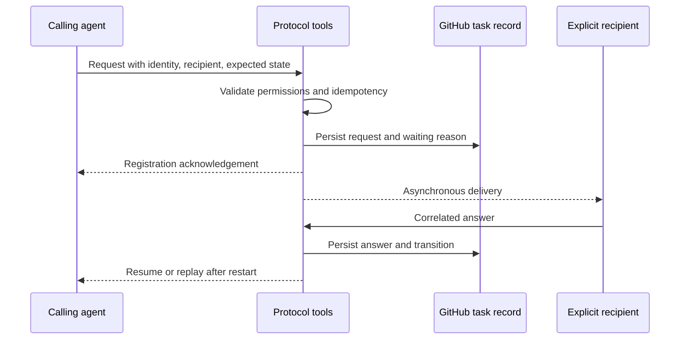
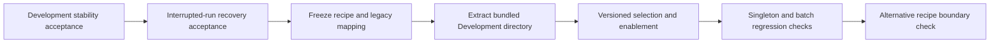
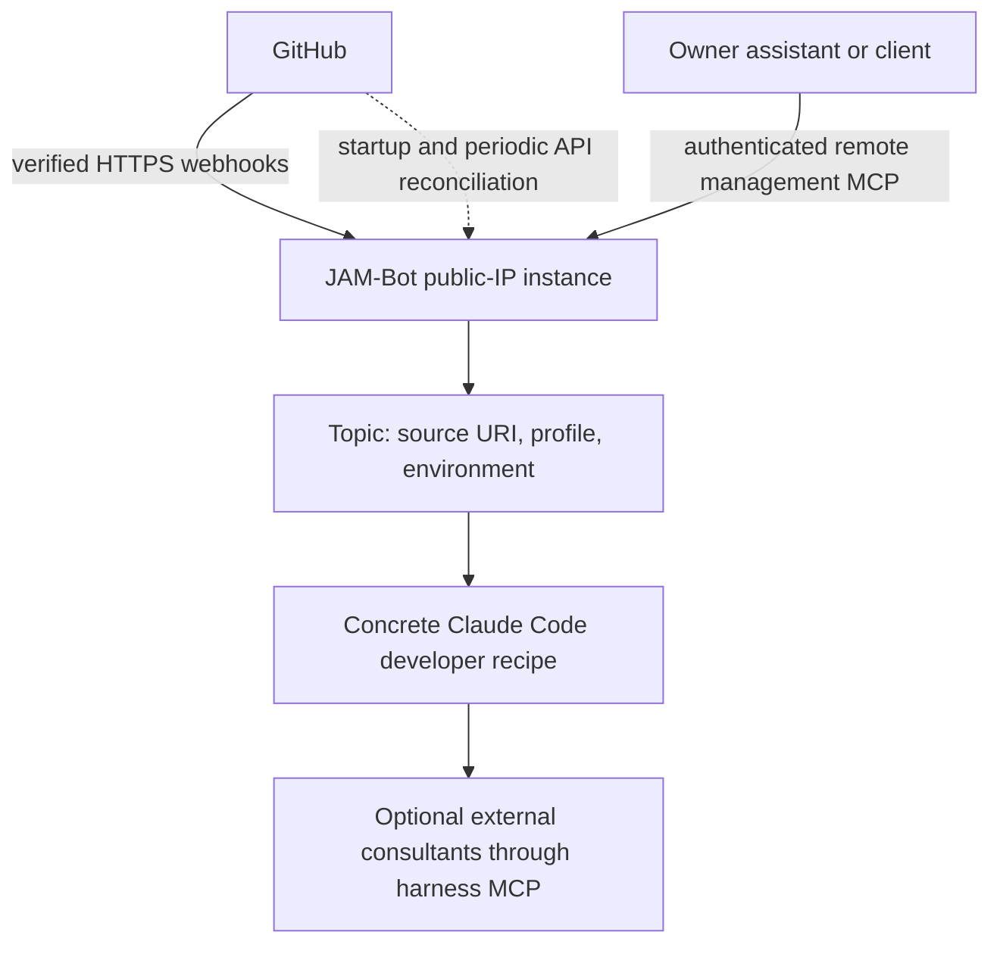

# JAM-Bot — Product Requirements

**Discussion draft — 2026-11-14.** Repository: [alexmakeev/jam-bot](https://github.com/alexmakeev/jam-bot). Terms: [GLOSSARY.md](GLOSSARY.md).

This is the single requirements source of truth, not an implementation kickoff. Confirmed requirements describe desired behavior, not delivered capabilities. Implementation beyond an explicitly authorized experiment requires a separate user command. Issue [#1](https://github.com/alexmakeev/jam-bot/issues/1) now authorizes a readable TypeScript/Node.js local recovery prototype, not production or the whole MVP. Critical open questions below block the affected implementation. IDs remain stable; retired IDs are not reused.

## 1. Intent and scope

JAM-Bot coordinates development through GitHub on machines supplied by the user. The name evokes tasty jam and, secondarily, a crowd or traffic jam. The autonomous core is open source under the existing MIT license, operated through commands, configuration, and a small management API. A possible proprietary web UI belongs in a separate private repository and is outside the core/MVP.

Keep the system extremely light: thin scripts and wrappers, minimal machinery. Every added component should justify its maintenance/resource cost and explain a simpler alternative. No performance or memory savings are promised.

## 2. Confirmed requirements and acceptance criteria

Criteria are future checks, not claims of completed validation.

### Installation, identity, and execution

| ID | Requirement | Acceptance criterion |
| --- | --- | --- |
| JB-01 | Install through an assistant over SSH on a user-provided server, initially without repositories. MVP GitHub App setup is manual, with instructions and keys on that machine; an existing App may be used. | After initial setup, a verified repository access grant automatically connects that project. Once connected, the GitHub App posts one short informational issue in the repository, addressing its owner or designated human maintainer, confirming readiness to receive work cards and explaining how to submit one. The notice carries no Task type. Retries, restarts and regrants reuse the original notice even after it is closed. Revocation pauses its work and preserves its directory, journal and coordinator identity. Regranting access to the same GitHub repository ID resumes the existing project. Credentials and harness readiness are checked before service starts. Duplicate deliveries and a server restart between revocation and regrant leave one project directory and one active coordinator. |
| JB-02 | Discover all repositories already accessible to the App and newly granted access. When permissions suffice, create owner/repo directories and one JAM context/process per repository without duplicates. MVP identity is repository URI. | Repeated discovery produces one project per URI; two accessible repositories receive separate contexts. Rename/transfer requires manual update for MVP. |
| JB-03 | Use one service system user per machine and only necessary administrative privileges. Every repository has its own directory/environment. | A second project creates no second service user; required privileges are documented. Running the entire agent runtime as root is not approved. |
| JB-04 | Use minimal wrappers and harness-native agent management. | Each long-lived component has a necessity/cost explanation; no duplicate agent platform, universal framework, or DSL is introduced. |
| JB-05 | Claude Code is the first default harness, with one default subscription per server in MVP. Topics select concrete work profiles with configurable launch commands and defaults; environment/template values may be supported. Preserve JAM, team, teammates, and short-lived subagents. | A repository can override the command without an account manager; the chosen execution path demonstrates the required team behavior. Feasibility remains an open gate. |
| JB-06 | One approved development card has one feature branch/worktree and a responsible developer; JAM coordinates parallel work through harness capabilities. | Concurrent development cards have distinct branches/worktrees and clear ownership; reconciliation avoids live duplicates. |
| JB-07 | Developers may use short-lived subagents without a separate registry/control layer. | Delegation uses harness capabilities and does not require a new JAM-Bot management entity. |
| JB-08 | Bound parallel execution to protect server resources. | The selected configurable limit is enforced; its values and waiting behavior remain to be decided. Up to 30 existing teammates is a capacity wish to investigate, not a verified limit or a requirement for 30 active workers. |
| JB-16 | MVP is GitHub-only; revoked access stops repository service while preserving its data. | Revocation stops further service for that repository without deleting retained work. |

### GitHub interaction and safety

| ID | Requirement | Acceptance criterion |
| --- | --- | --- |
| JB-09 | Listen to issues and PRs, including comments/reviews and branch updates as distinct events; reading requires no mandatory @mention. Instructions and tools determine actions; the engine does not judge agent decisions. | Each supported event reaches the correct context; reading alone does not authorize a task. Own bot events do not loop. |
| JB-10 | Isolate neighboring projects, including secrets, files, and execution. Directories/worktrees are not security boundaries. | Cross-project access tests enforce the agreed threat model, including any container access. Mechanism remains open. |
| JB-11 | Preserve events, recover after restart, and avoid duplicate execution. | Repeated delivery and crashes around processing do not lose accepted work or repeat side effects; recovery reconciles remote records and live local work. |
| JB-12 | Recognize all permitted accounts of the user and other permitted participants. Enforce permissions beyond prompts or hidden tools. | Allowed accounts work; unauthorized comments/actions are rejected by enforcement. Mention or comment authorship alone grants no authority. |
| JB-17 | Publish concise English GitHub Flavored Markdown in every bot issue comment. A short answer can be a paragraph. Use a list for plans and steps, separate a requested action from the result, and preserve paragraphs, indentation, links and code blocks from generation through publication. Validate the comment structure before posting or editing. Keep attachment-only comments as the single verified Markdown link. Substantial details belong in attached English .md files. | No flattening of line breaks or mid-sentence truncation. The published plan renders as a list and its next step renders separately. A task timeline points to readable attachments rather than long inline specifications; target human timeline is 1–2 screens, not a guarantee for an unlimited history. The GitHub App publishes verified English Markdown as an Issue Artifact and links it from the original work card. |
| JB-18 | Distinguish applying GitHub suggestions to a PR branch from merging a PR. Subsequent branch updates may trigger review without loops or repeated review of the same revision. | A suggestion changes the PR branch; event/revision tracking suppresses repeated review of the same revision. Reviewer role is future scope. |

### Development, integration, and release maturity

| ID | Requirement | Acceptance criterion |
| --- | --- | --- |
| JB-13 | Developers use TDD: verify a green baseline, add and run a meaningful regression test to RED before implementation, then implement until the full unit suite is GREEN. Preserve the RED/GREEN revision identities and results. Implementation consultations start only after the complete unit suite passes; advisers assess correctness, simplicity and test coverage. Extend existing tests when appropriate and add minimal meaningful tests. During work use targeted tests; before handoff run the full unit suite. E2E/container testing must remain possible within isolation. | Handoff records the exact revision and full unit results; necessary container use does not invalidate JB-10. |
| JB-14 | The worker hands off code and unit results. The integrator owns browser and E2E acceptance on the exact combined candidate in an isolated virtual browser. Browser evidence is due at integration. Each topic’s repository profile defines its named environments and deployment recipe. For each transition, specify the source revision or build channel, destination environment, trigger (successful checks, schedule, or approval), required checks, and any acceptance period. Branch names, build channels, and deployment destinations are configured separately. A project can deploy the latest green nightly directly to its development environment, or retain a release candidate for testing and hotfixes before production. A stable release requires explicit owner or authorized-maintainer approval of the exact tested SHA; a hotfix receives fresh checks and a new approval. | Two repository profiles with different environment names and promotion routes can run on the same service. Each deploys only to its configured destinations when its conditions are met. Shared promotion references the exact tested revision and current base; failed checks block promotion. Stable denotes maturity, not deployment. Elapsed time alone is not evidence that testers tested. |
| JB-15 | Eventually make this PRD sufficient for JAM to decompose, implement, and assemble the product on a separate command. | Resolved requirements allow unambiguous tasks and acceptance; this draft has not reached that threshold and does not trigger work. |
| JB-19 | Before a developer starts, an architect on a strong configurable model produces an attached Markdown spec based on current code and planned tasks. Describe module changes, contracts, dependencies, and tests sufficiently. Distinguish planned dependencies from existing code. Managed GitHub work cards use native issue dependencies for approved inter-card prerequisites. | The developer receives a minimal sufficient spec. A dependent card waits for verified publication of every required predecessor into dev and starts from code containing those revisions. Closure without integration leaves the prerequisite unresolved. Unrelated eligible cards can proceed. |
| JB-20 | JAM selects compatible ready development branches for integration. Target about ten and prefer three or more when there is concrete evidence of imminent completions. Each batch contains at most fifteen. Start immediately with a lone ready task if no other completion is near. Before batch checks, publish the same concise yellow integration-start status in every member issue, then update only on a result. Record each card’s result separately. When diagnosis identifies faulty members, attach their correction reports and return them to the worker. Reassemble the remaining branches without the excluded members, announce the new test round in each remaining issue and rerun all combined acceptance checks. Uncertain attribution keeps the batch blocked. | A bounded wait measured from the oldest ready task prevents starvation. Claims survive restart and identify exact revisions. Failed batches retain their evidence. Shared promotion requires verification against the current base. |
| JB-21 | For a profile using a release-candidate branch (main in the pilot), when a bug is found, a fresh instance of the same integrator role uses RC plus fix in its own worktree/environment, runs the full checks without shortcuts, updates main, and restarts acceptance. The regular integrator continues its next batch, incorporates the main fix, and fully retests. | Both paths record full unit/E2E results for their exact revisions; shared promotions serialize and verify the expected base. Shared dev is not rebased. |

After full unit and E2E checks pass and the tested candidate lands in shared dev, retire each included feature worktree and its local journal. Verify that its tested feature revision is included, the worker has stopped and there are no additional local changes to preserve. Retain worktrees for failed, pending or divergent work. Cleanup applies to worktree directories; Git branch deletion is a separate policy. Close each integrated execution work card as completed, retaining its discussion and links as project history. Linked intake reports have their own lifecycle. Retry an interrupted close idempotently.

The diagram illustrates the calculator pilot profile. It holds dev-to-main promotion during RC acceptance so new features can continue in dev while the candidate is evaluated. Other repositories select their own promotion routes under JB-14.

### Durable state and communication protocol

| ID | Requirement | Acceptance criterion |
| --- | --- | --- |
| JB-22 | The project source of truth includes remote cards, specifications, discussions, and code. Execution work cards and attached specs record approved scope, shared status and decisions; remote branches preserve code. A minimal local operational journal may help recovery but must not become a competing business-status database. | Restart reconciles local worktrees/processes with remote task records; it does not blindly launch every open issue, including waiting, dependency-blocked, or already-live work. |
| JB-23 | Keep intermediate findings, diagnostic logs and the next step in a Git-ignored directory inside the assigned worktree. After a process or session failure, inspect the surviving diff, files and local checkpoint alongside the issue and specification. JAM-Bot records each role assignment, consultation request and response, handoff, review decision, blocker, retry, and verified result in the original work card as it occurs. For development, Architect, Worker and Integrator each maintain one English checklist comment on the original issue. Render progress with non-interactive emoji (◻️ planned, 🟨 active, ✅ verified). Keep the visible handoff to a checklist, a short English decision or result and its primary Markdown artifact. The next role uses the verified artifact. Record each actual adviser outcome, attach the specification and correction reports to the responsible role, and keep the card open through verified integration into dev. Direct assignments and consultations use one result comment. Separate actionable mentions may request a human decision. Each update identifies the responsible role, the input or artifact version, the outcome or pending work, and who acts next. Publish each result in the same progress comment with links to all of its verified native issue artifacts. When a file becomes available later, update the same bot-authored comment; replay must retain its identity and avoid duplicate announcements. Attach substantive specifications, reviews, and reports as English Markdown. During recovery, read the issue artifact collection (including all pages) alongside the authenticated issue timeline. Reference the tested commit and deployed version at completion. | Repeated local checkpoints produce zero GitHub writes. The replacement resumes unfinished work from available evidence. Preserve the assignment and native harness handle. Disk loss can destroy local logs and unpushed changes. |
| JB-24 | Protocol operations use semantic names, not agent-role names. Any agent level may communicate, and tools may be delegated to subagents. A skill teaches protocol; MCP tools validate and persist it. No free-text regex establishes authoritative statuses. | Operations identify caller, recipient/link, correlation/request identity, and waiting reason where needed; a request is acknowledged quickly and answered asynchronously. Replay/idempotency and expected-state checks survive restart. |
| JB-25 | Do not claim atomicity across GitHub comments, labels, and notifications. Keep one compact protocol module, not a universal messenger/workflow engine. | Partial external-write failures are detectable and reconcilable without duplicate logical transitions or false success. |

Exact operation names/schemas and the phase/waiting-reason vocabulary remain proposals. The former role-specific ask_leo concept is withdrawn.

This is a logical interaction, not an atomic transaction or a selected transport.

### Intake, work profiles, management, and deployment

| ID | Requirement | Acceptance criterion |
| --- | --- | --- |
| JB-26 | Separate intake reports from execution work cards. On GitHub, Bug and Feature issues and Discussions can serve as public intake. After a maintainer and ChatGPT synthesize the relevant discussions into a self-contained task and the maintainer approves it, ChatGPT creates a separate English execution issue with links to the source discussions. The discussions stay open. Later public replies do not amend the approved scope. JAM-Bot ignores issues and comments from outside the authorized human maintainer set. Before journaling content, fetching attachments or notifying JAM, check the author of each issue or comment independently. Skip untrusted contributions even inside a trusted thread. A maintainer may publish a separate trusted report; create separate linked work cards with many-to-many relationships. A bot may propose/create a card, but only an authorized human approves execution. Approval in an authenticated trusted conversation is sufficient: Codex creates an English work card with verifiable attribution and sets its native Task type on behalf of the linked human. A human may also create a Task directly or assign Task to a finished draft. | Ten duplicate reports can link to one card; one report can link to several cards. Before a worker starts or resumes, verify the current work card conversation is locked against outside comments. Hold work if the provider reports it unlocked or cannot confirm its state. Maintainer approval remains independently required. Before every execution start or resume, query GitHub for the approver’s current effective role and match the immutable user ID to the saved approval. An API failure or revoked role prevents execution; logs and cached role history cannot grant permission. Unapproved cards never execute. Verify who approved; bot self-approval is rejected. Small scope adjustments within agreed goals and values are allowed; strategic/material changes outside those boundaries require human resolution and renewed approval. Approval is distinct from queue state and does not bypass dependencies or resource limits. |
| JB-27 | A topic binds a concrete project source of truth (GitHub repository for MVP), work profile, and environment. A work profile specifies the orchestrating harness, launch command, instructions, hooks, MCP/tools, and settings. Keep the bundled Development recipe in a separate profile directory with its instructions, hooks, role-tool policy and workflow. Topics select an enabled profile and version; pin that identity for active work and recovery. Disabling a profile prevents new admissions without silently migrating active cards. The platform owns generic intake, authorization, durable transport, storage and management; TDD, role order, advisers and test routing belong to the selected profile. The bundled Development architect and integrator use medium reasoning effort as their selected default; consultant effort remains project-configured. MVP ships one bundled example. Future profiles may use another development method and be added as separate directories; external plugin loading is future scope. Deliver concrete recipes without a general plugin framework. | Topic configuration resolves to a specific runnable recipe. The core does not attempt arbitrary interchangeability or duplicate orchestration performed inside the chosen harness. A consultant profile may use a different configured harness even with the same binary. |
| JB-28 | Work profiles declare required/optional tools and access methods (subscription or API), settings, and references to separately stored credentials. | A missing required dependency fails clearly before startup; a configured optional dependency is available, while an unconfigured one is not required. Runtime consultant failures follow profile-defined behavior, whose exact fallback semantics remain open. Secrets are not embedded in profiles. Authenticated management provides two project/environment-scoped API operations, secret set/replace and masked get/list, with explicit bindings to permitted consumers. Store values outside Git in the project credential store; MCP responses expose aliases, presence and masked previews with two leading and two trailing characters. Values of four characters or fewer are fully masked. Full values are never returned. Exclude values from request/error logs. Recovery restores saved bindings and provisioned values; recovery after disk loss requires credential backup. |
| JB-29 | Provide a small language-independent HTTP REST management API with an OpenAPI contract covering operations, inputs, outputs, and errors, with schema-derived/generated documentation. Thin CLI and MCP interfaces use the same application operations without duplicated business logic. | Contract and interfaces agree for the selected operations and errors. No GraphQL or Python in MVP. Management MCP is distinct from the agent communication protocol in JB-24/JB-25. Exact endpoints, schemas, and versioning remain open. |
| JB-30 | MVP requires a public IP and externally reachable HTTPS endpoint. Webhooks are primary event delivery; authenticated remote MCP supplies management. Startup/periodic API reconciliation recovers dropped events, downtime, existing accessible repositories, and missed permission changes. | Verify external reachability, TLS, provider-specific webhook signatures/secrets/source checks, and management authentication/authorization. Replayed webhook/reconciliation data remains idempotent. A public IP alone does not satisfy readiness. Private/CGNAT machines are not the default supported MVP deployment. |
| JB-31 | Each JAM-Bot instance exposes authenticated MCP management. An owner may connect multiple named server endpoints to an assistant/client and discover placement through topic inventories. Persist a source/project URI-to-server/topic routing map, verify the live server before mutation, and clarify ambiguity. | Routing survives conversational context loss; mutations verify the actual destination and permissions. Endpoint URL/ID is not authorization. Storage location is open; client/account support for connecting multiple remote MCP servers must be verified, not assumed. No central fleet service is required. |

### Planned Development profile extraction

The JB-27 extraction is scheduled after Development stability acceptance. The architecture review found no dependency on relocating files to complete the current pilot. Moving dispatch, role policy and checkpoint ownership together before acceptance would obscure the causes of existing failures.

1. Establish the baseline through an observed approved issue, architecture and required consultations, verified TDD, worker review, combined acceptance, a confirmed merged PR into dev and issue closure. Verify interrupted-run recovery without duplicate execution. Keep failed runs and their operator interventions identifiable.
2. Freeze that accepted recipe and record its profile identity. Map core responsibilities and Development policy against JB-27. Preserve existing identifiers and checkpoints through an explicit legacy mapping.
3. Extract the accepted recipe into one bundled `profiles/development/` directory. Move executable workflow policy, role instructions, progress rendering and example recipes together, preserving behavior. Retain generic authorization, routing, transport, persistence and artifact publication in the core.
4. Add persisted topic selection and enable/disable behavior. Pin the selected profile version on work cards and batches. Existing work resumes its pinned recipe; missing or changed versions produce an explicit recovery conflict.
5. Repeat singleton, batch and interrupted-run acceptance on Test and Sandbox. Verify disabled-profile admission and use a small test-only alternative recipe to demonstrate that the core does not require TDD or a fixed role order. External extension loading remains future work.

The refactor is complete when the bundled Development recipe preserves the accepted behavior, active legacy work recovers correctly, profile selection is visible through management, and an alternative recipe runs through the same core boundary.

**Owner management for the MVP (JB-27, JB-29–31).** Expose server identity and topic inventory, GitHub App project discovery and connection, the repository's default work class and environment, work and integration status, and reconciliation of work already awaiting operator review. Provide durable operation receipts for asynchronous deployments. A client pins named HTTPS endpoints and source URI–topic placement, refreshes their live identities before changing state, and asks the operator to select a server if several advertise the same repository.

The owner can describe a named deployment environment from the project conversation. Store each instance definition under its project, beside the coordinator and worktrees. A definition carries a lifecycle tier, nonsecret application settings, optional service endpoint and references to operator-provisioned secrets. Saving a definition and deploying a specific release are independent actions. Report the revision and health observed on the destination machine. Preserve explicit approval of the exact stable revision. The machine operator grants repository and deployment capabilities during installation. Share the operation and validation implementation across REST, MCP and CLI.

**Managed GitHub repository intake standard (JB-26).** Offer two public issue forms, Bug report and Feature request, with the corresponding native Bug and Feature types. Disable blank issue creation in the web chooser and omit any public Task template. Reserve manual Task assignment for authorized repository collaborators. Public or untyped submissions, including those created outside the chooser, cannot start execution. At dispatch verify the human actor's current repository authority (JB-26). [GitHub issue type permissions](https://docs.github.com/en/rest/issues/issues#update-an-issue) and [issue form configuration](https://docs.github.com/en/communities/using-templates-to-encourage-useful-issues-and-pull-requests/syntax-for-issue-forms).

Approved work cards carry one execution class. An assignment goes directly to its responsible teammate. A consultation goes directly to a specialist for advice. Development proceeds through architecture, implementation and integration. A design request adds a designer before architecture. The architect receives the designer’s brief and the integrator evaluates the implemented change against the specification. Public bug reports and feature requests enter intake separately. Their content and labels cannot authorize a teammate or choose a command. Validate immutable human attribution, current repository authority, locked card and the authorized scope at dispatch and resume. Choose the profile from the trusted class mapping for that topic.

For Development, use one LEO coordinator per topic and one persistent named task manager per active work card. A shared project architect owns plans and integration. The task manager owns the card's execution and may build work packages directly or delegate them to unnamed one-off subagents. Keep one writer at a time in the card checkout and apply deterministic integration gates through the Development profile. Recover card ownership by reconciling the issue, checkpoint and checkout before dispatch. This is the target lifecycle; native lifecycle validation remains open under Q-03.

Each class publishes one current progress status. Assignments and consultations show queued, in progress and completion. Development also shows planning during architecture and in validation during integration. Each class can show blocked while awaiting a decision. Record the resolved class with the local assignment. Close completed work according to the class outcome.

Creating an open Task or explicitly changing a draft to Task expresses the human actor's approval. Verify the actor's current effective repository write access or higher and immutable identity before intake and execution. Lock the issue automatically and verify the current Task type, scope and lock before starting. Repeated deliveries and the lock event itself cannot dispatch another worker. The native type identifies the work card. Its class selects a route within the JAM Developer profile. Bind a default profile and work class to the repository. JAM Developer defaults to development. An ordinary Task displays only its current status label; store its resolved class in the assignment. An explicit assignment or consultation can override the default. Store approval provenance in the journal. Close finished work as completed and cancelled work as not planned; retain type, history and links.

External harnesses/vendors/models may be called as consultants inside the orchestrating harness through MCP. Codex and Antigravity are the selected optional consultants for the initial deployment. Record an authenticated end-to-end result for each before promoting the profile. Additional consultants do not guarantee improvement: quality must be measured.

### Autonomy, diagnosis, consultation, and project guidance

| ID | Requirement | Acceptance criterion |
| --- | --- | --- |
| JB-32 | JAM acts autonomously within project goals and values, including small scope adjustments; escalate value conflicts, dead ends, or strategically ambiguous choices. | Routine decisions do not require a second click; escalation explains the conflict and proposed reusable principle. Architects group unresolved questions against original cards and values and propose an applicable future principle. |
| JB-33 | On recovery compare actual worktree/branch code, card expectations, and checkpoint, correct stale status, and skip completed steps. JAM reports failure and diagnostic outcome, may restart, and involves a human if a retry loop is dangerous. | From the original issue timeline and its artifacts, a replacement can identify completed and pending steps, the latest inputs and outputs, and the next responsible role. Reconcile these with actual code and running work before resuming. Recovery preserves existing results and avoids duplicate dispatch, publication, or deployment. During autonomy acceptance, record any operator intervention and the workflow gap that required it. Verify the fix on a fresh test work card from admission through the confirmed dev publication and closure, using observation only. An unresolved blocker names its owner and required action on the original issue. |
| JB-34 | Keep one repository and its team on one owning machine. Conflicting starts or returning zombie owners warn and prevent duplicate processing. | Exercise simultaneous start and stale-owner return. Do not infer safe cross-host takeover from timeout alone; remote fencing remains a deployment gate. |
| JB-35 | When analyzing or resuming a work card, read the authorized contributions in its current description and comments, including the relevant files attached to those contributions (JB-26). An unreadable required attachment must be surfaced before work depending on it starts. Before uploading a specification, bind its exact bytes, filename and destination to the approved work card. Before publication and developer handoff, verify the uploaded bytes and a single expected attachment reference; extra text or files block dispatch. Original and fix specs are .md attachments in the originating issue; repository file URLs are not substitutes. Integrators finish every executable test, retain a results map, logs, commands, exact revision, and reproducible environment. Diagnose failures including branch combinations, then publish the fix assignment and attached fix-spec in the same issue for JAM/developer. | After integration fixes, rerun the full suite; unavailable tests are explicitly recorded rather than called passed. Retrieve the native Issue Artifact and verify its original bytes, creator and issue before the dependent stage. |
| JB-36 | Architect prepares its own solution before consulting; integrator consults during diagnosis; developer submits requirements, spec, and diff for pre-handoff review. Profile consultants are arbitrary, run parallel fan-out, and all successful responses are awaited; the list may be empty. | Access may use subscription/API/proxy via secret references. The architect owns the waiting and retry decision for architectural advice. The service records completed reviews and executes retries for the affected consultant. Use a configurable response deadline and available progress evidence. Approximately 15 minutes is a recovery guideline. A healthy request may continue longer. Escalate unresolved failures to JAM. If mandatory implementation review stalls, JAM delivers the event to the architect for diagnosis and records the disposition on the originating issue. Recover transport failures from existing delivery evidence before retrying. An explicit provider refusal keeps the exact candidate pending and requires an actionable escalation to the responsible maintainer. Different model families may offer another perspective without guaranteed improvement. |
| JB-37 | The managed repository’s compact project description lives in `.jam-bot/VALUES.md`. Keep project terms and values, one line per human responsibility (area, role, GitHub @login), and short environment and release rules (JB-14) together; all agents read it before changes and after recovery. Initial project description can supply terms/values: missing file does not block initially approved work. | Missing guidance does not fabricate values or block initial authorized tasks. Optional .jam-bot/vocab.<lang>.json is only loaded by human-facing Codex for the relevant language, accepts corrections, and needs no JAM hooks. People use their language; JAM, cards, and docs use English. |
| JB-38 | Carefully extend existing root AGENTS.md. Give maintainers a simple instruction and welcome link; START.md is only a candidate. Maintainer-mode Codex has code-read and authorized issue-read/write access, without code-write authority. Runtime config/credentials live on the server; multiple-profile operations are unresolved. | Maintainer credentials/workspace enforce code-write restrictions; this explicitly authorized implementation experiment is a separate role/scope. |
| JB-39 | When a material decision needs approval, pause the affected action and ask the listed human responsible for that area by @mention in the original issue. If nobody is listed for the area, address the designated project lead, then the repository owner. Also notify the verified human who initiated the work card by @mention; deduplicate when that person is already the responsible recipient. Any authorized maintainer may decide regardless of specialty. If the authorized initiator already requested that exact decision, use the attributed request as approval. | Record the scope, actual decision maker, and decision in the issue. A mention, job title, or authorship of a different request grants no approval. Stable approval still identifies the exact build (JB-14). |
| JB-40 | Publish only changes to a visible checklist state, human question, blocker, or completed handoff. Keep internal checkpoints and interim logs locally. At handoff attach the role’s final Markdown result to its status comment. A human issue comment ends the current editable progress comment. Put a pending question, ❓, the responsible person's mention and the stage artifact together. Publish subsequent progress below the human reply. | Replay preserves the question and its artifact; each role updates its new comment in place. A comment alone grants no new execution authority. |
| JB-41 | Provide JAM an MCP operation to attach additional intermediate evidence to the original issue only on an explicit human request, including a selected teammate's assignment and verified answer or a requested image. | Match the request, issue and file, retain attribution, omit credentials and unrelated conversations, and reuse a verified attachment on retry. Binary image delivery needs verification. |
| JB-42 | Configure the active consultant list per repository through the existing authenticated management REST/MCP pattern. The owner selects models for the project's responsibility level; agents do not classify individual tasks into Low/High tiers or automatically downgrade reviews. Each named consultant selects an approved provider adapter, explicit model, supported reasoning settings and response deadline, with credential references kept separately. Multiple named entries may use the same provider. At each consultation point, invoke all active configured entries in parallel under JB-36. | During project initialization, expose the effective consultant settings and management operations before the first work dispatch. If settings are absent, initialize explicit defaults of Codex Sol and Antigravity Argon and inform the owner that defaults were applied. Treat the default families as latest-available Sol and latest-available Argon selectors. Before new work starts, resolve them against the configured provider/account catalog, verify availability, and record the resolved model identifier and any exposed snapshot/version metadata with the work card. Keep that resolved identity throughout the card and recovery rather than switching models mid-flight. New cards may resolve to newer available versions; an explicitly pinned owner choice remains pinned. Do not invent unsupported latest aliases, guess identifiers, or silently substitute another family. If the provider cannot expose sufficient catalog/version information, report that limitation rather than claim exact latest-version selection. Existing explicit project choices are retained. Save the effective configuration with active work for reproducible review and recovery; later owner edits apply to future work. Deployment variables and secrets are not arbitrary execution-command templates. This requirement is confirmed; management editing, default initialization and availability validation remain to be implemented. |
| JB-43 | The Development architect and independent consultants can independently list, search and read a pinned repository snapshot rather than relying exclusively on supervisor-selected excerpts. Give them a readable index of approved planned and in-progress specifications, including status, original issue/artifact provenance, revision and digest; retrieve full specifications on demand. The supervisor prepares and caches this verified view locally. | Pin code and specification-view identities for each run and recovery; distinguish planned work from implemented code. A read-only mount of a changing worktree is not an immutable snapshot. Repository content and specifications do not grant new execution authority. Expose bounded, paginated reads/searches without host credentials, unrestricted paths or writes. Acceptance diagnostics require real reads of the specification index and a relevant file omitted from the prompt, and verify containment, denied writes and recovery on Test/Sandbox. Routine stages select evidence based on their task. The candidate implementation requires live acceptance before it is declared complete. |
| JB-44 | Cleanup policy and the optional JAM Cleaner role belong to the selected work profile, not a universal platform retention policy. In Development, invoke Cleaner after the integrator has verified successful checks and the merged dev result; preserve the user's requested post-completion order. The profile declares eligible task resources, reusable-cache retention/size policy and retained recovery/rollback evidence. Other profiles may use another policy or omit Cleaner. | The platform executes only profile-approved, task-owned resource operations and prevents deleting active/shared resources or protected credentials and retained rollback evidence. Before deletion, durably record an auditable manifest identifying the task, profile, cleanup run, eligible resources and reason for removing each. After execution, record each removed, retained, skipped or failed resource and the measurement method and byte counts. Distinguish the measured size of removed data from actual reclaimed filesystem space when those differ; do not label unmeasured estimates as freed gigabytes. Publish one concise English JAM Cleaner status comment in the original issue after closure and attach the detailed Markdown manifest/result so later investigation can identify exactly what Cleaner removed. Build this status from confirmed execution receipts, not model assertions. Include measured filesystem available space and percentage used with green below 70%, yellow at 70–84%, orange at 85–94% and red at 95% or above. Make replay safe. A generic agent instruction to delete whatever looks unnecessary is not sufficient ownership evidence. The candidate Cleaner implements task and batch worktree/branch cleanup; shared-cache eviction remains deferred until exclusive ownership and a concrete retention policy are defined. |
| JB-45 | The Development profile includes configured lint, formatting, type and generated-code style checks in its deterministic quality gate before implementation consultations. Require baseline checks and tests GREEN, then static checks GREEN plus assertion-level RED, then implementation checks and the full unit suite GREEN. Generated/changed code and tests introduce no comments; keep explanations in documentation and handoff artifacts. | Invoke pinned trusted tools and fixed recipes rather than arbitrary package scripts or executable repository configuration. Record per-check outcomes, tool versions and exact revision; distinguish unavailable checks from passing ones. Static, import, infrastructure and timeout errors do not establish RED. Enforce new-comment detection with language-aware tokens, preserving existing comments and allowing comment-like text inside strings. Version the evidence so older test-only receipts cannot satisfy a stronger gate. The stronger candidate gate is opt-in during Test/Sandbox acceptance; existing receipts cannot prove the new evidence version. |
| JB-46 | Expose bounded owner-authenticated management diagnostics through the shared REST/MCP application operation. Start with a compact repository summary; drill into one registered issue, agent checkpoints, progress events, report indexes and selected reports. Support pagination, response-size limits and explicit role filters where applicable. | Never expose arbitrary host paths, credential stores, raw prompts, private model reasoning or terminal transcripts. Return safe execution metadata and retained public work products; redact recognizable credentials in report text before pagination. Distinguish recorded checkpoint age from proof of a hung process. Preserve server/repository identity checks and reject a report belonging to another issue. Record actual execution intervals where available and mark inferred intervals explicitly. |

The [architecture specification](ARCHITECTURE.md) guides issue #1. A local journal is operational only; SQLite remains a candidate, not a selected product database. Prototype evidence must separate fixture execution, actual Claude CLI calls, and actual interactive Agent Teams.

## 3. Proposals and unverified candidates

| ID | Candidate | Complexity cost / simpler alternative |
| --- | --- | --- |
| P-01 | Docker per project or Linux sandbox/Landlock for isolation. | Define threats and test a minimal mechanism first. Arbitrary Docker daemon access does not preserve isolation automatically. |
| P-02 | Copy node_modules or use shared links with proposed copy-on-write. | A symlink is not COW; shared mutable dependencies are unapproved and copying may not be faster. Measure independent installs first. |
| P-03 | Retired: primary polling transport. | Superseded by JB-30; startup/periodic API reconciliation is recovery, not the primary event loop. |
| P-04 | Persistent interactive Claude Code session plus Channels. | Experimental feasibility candidate only; Channels are MCP push in research preview. No claim of unattended/restart readiness. Noninteractive -p/Agent SDK does not create Agent Teams. |
| P-05 | Existing GitHub MCP for repository operations. | Verify installation authentication/refresh, required operations, and attachment upload; do not create an account in MCP. |
| P-06 | One service issue with concise instructions and @mention of the connecting person after real readiness. | User should be able to write tasks/messages immediately. Exact issue mechanism is open; no new issue on every restart. GitHub notification delivery depends on user settings. |
| P-08 | GitHub App manifest onboarding later. | Manual App creation is sufficient for MVP. |
| P-09 | Reduced memory usage from team organization. | Hypothesis requiring measurement; memory/swap is no capacity guarantee. |
| P-10 | Retired: a separate JAM-Bot approver list. | Superseded by the GitHub role check in section 2. Approval evidence and recovery remain Q-01/Q-08. |
| P-11 | Adopted in JB-29–31. | The live OpenAPI document describes the selected operations. |
| P-12 | Future optional paid/proprietary relay for private/home instances: outbound connection forwarding webhooks and MCP calls. | Outside MVP, with multi-tenant security and operational costs; one-click onboarding is a UX goal, not demonstrated capability. No central dependency now. |

GitHub repository roles express access permissions, not expertise. Organization teams can receive @org/team mentions; users can receive @handle mentions. CODEOWNERS maps file paths to ownership/review requests, not a general directory of architects. Do not invent real handles.

## 4. Open implementation gates

| ID | Decision or evidence needed | Blocked area |
| --- | --- | --- |
| Q-01 | Verify the GitHub actor/role lookup, conversation identity binding, approval audit and reapproval enforcement, secret access, and minimum App permissions. | Safe onboarding, execution, and protocol actions. |
| Q-02 | Threat model and isolation mechanism with one system user, administrative capabilities, and safe container testing. | Multi-project execution. |
| Q-03 | Demonstrate required JAM/team/teammate/subagent lifecycle with configurable harness launch, message delivery, restart/reconnection, resource limits, and measured capacity. | Agent runtime. Claude Code default is confirmed; a rigid harness binding is not. |
| Q-04 | Webhook reachability/TLS setup, source/signature verification, deduplication, ordering, durable records, reconciliation intervals, recovery, and partial-write handling. | Reliable interaction and resumption. |
| Q-05 | Exact dev/main/stable branch operations, integrator handoff, expected-base serialization, acceptance hold/release, tester complaints, and configured acceptance checks/duration. | Release workflow implementation. High-level workflow in JB-14/JB-21 is confirmed. |
| Q-06 | Minimum first end-to-end delivery, supported public-IP server environment, and implementation language runtime details. TypeScript is selected, Node.js for the prototype; Python and Go are not the selected stack. | Remaining delivery/runtime planning; language choice is resolved. |
| Q-07 (resolved for GitHub) | The installation creates native issue artifacts, reads them back and records the matching comment and original digest for recovery. | Verified on the [calculator redesign](https://github.com/alexmakeev/jam-bot-test/issues/20/artifacts/1). |
| Q-08 | Agent protocol schemas, approval/label state reconciliation, phase vocabulary, addressing and responsibility routing, retry boundaries, and recovery audit. | Compact protocol implementation. |
| Q-09 | Management operation set, OpenAPI schemas/errors/versioning, authentication/authorization, asynchronous operation status, and routing-map storage. | Management API and multi-machine routing. |
| Q-10 | Concrete profile configuration and runtime handling of unavailable optional consultants, credential references, and measured quality. | Work-profile execution details. |

## 5. Non-goals and deferred work

- Paid hosting, billing, web UI, subscription management, automatic account rotation, or a general orchestration framework in MVP.
- Stable provider-ID abstraction in MVP; URI identity is deliberately chosen. Rename/transfer automation is later.
- GitLab/Gitea support now, or promises that adding them will require only a small refactor.
- A standalone consultant/reviewer delivery recipe as the primary MVP scenario; developer is the current focus. Optional consultants inside a concrete harness recipe do not imply a universal compatibility layer.
- A compatibility matrix, universal provider API/plugin DSL, or account/subscription purchasing/rotation manager.
- Primary polling transport, private/CGNAT default deployment, or a central fleet/relay service in MVP.
- A mandatory OpenAI Secure MCP Tunnel: it concerns MCP transport, not a generic webhook endpoint or automatic sharing of desktop MCP into ChatGPT web. Specific ChatGPT web/mobile account integration is unverified.
- Relay implementation now. A future relay and proprietary UI may live in a closed repository; MIT does not prevent third parties from implementing alternatives.
- A separate control plane/registry for short-lived subagents.
- Production deployment implied by stable promotion.
- Importing CDX16 architecture or code as a required foundation. It was only an example of remote worker control on Hetzner; design starts from scratch.
- Final competitor assessment or promotional claims about Agent Orchestrator until the user's separate signal.

## 6. Documentation maintenance and evidence

Escalation audit (2026-11-17): four local material-decision tests pass, covering authorization, responsibility routing, waiting across restart, and a reply racing with pause. These tests use simulated GitHub responses. Remaining JB-39 acceptance work: guaranteed notification of the verified initiating human, consistent decision escalation from integrator and mandatory-review stages, and a live question → authorized human answer → restart → single resumption scenario. Current implementation requires the documented exact approval/decline command; natural-language answer handling is not established. This audit does not establish end-to-end escalation acceptance.

Keep confirmed behavior, candidates, open gates, and non-goals distinct. Update related sections together without duplicate specifications. Split documents only when genuinely necessary. Future agent-generated architectural attachments follow the same English and terminology rules.

External capability references, reviewed 2026-11-13; these are documentation evidence, not JAM-Bot integration tests:

- [Claude Code Agent Teams](https://code.claude.com/docs/en/agent-teams) — team lifecycle and noninteractive limitations.
- [Claude Code Channels](https://code.claude.com/docs/en/channels-reference) — MCP push and research-preview status.
- [GitHub diagrams](https://docs.github.com/en/get-started/writing-on-github/working-with-advanced-formatting/creating-diagrams) — Mermaid in Markdown.
- [GitHub attachments](https://docs.github.com/en/get-started/writing-on-github/working-with-advanced-formatting/attaching-files) — .md attachment support, not proof of automated App upload.
- [GitHub CODEOWNERS](https://docs.github.com/en/repositories/managing-your-repositorys-settings-and-features/customizing-your-repository/about-code-owners) and [teams](https://docs.github.com/en/organizations/organizing-members-into-teams/about-teams) — ownership and mention/access semantics.
