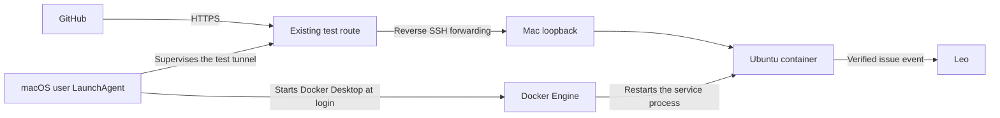

# Local service on the development Mac

Design for the test installation with one coordinator per configured repository. See [PRD](PRD.md) JB-01, JB-03, JB-27 and JB-30. The existing AM32 route supplies HTTPS for this test.



## Container

Keep the interactive Compose service for existing experiment commands. Add a dedicated service using the same Ubuntu 22.04 image, running as the existing jam user with an init process and a Docker restart policy. Run `node dist/src/webhook-service.js` as the foreground application. Publish port 19739 on host IPv4 loopback. Use the existing Claude subscription directory with read/write access for credential renewal. Persist SQLite WAL and checkpoints on a named Docker volume writable by UID 1000. Use Node.js 22.13 or later and keep the service working directory stable. An exclusive kernel lock on the state volume prevents a second service from taking ownership of the configured topics. Managed interactive Claude and the service additionally lock the same credential directory before starting so that refresh and session writes have one writer. Supply the webhook signing secret from a private host file and mount the GitHub App private key read-only at its own path. Set the allowed repositories and installations in local configuration. The service shares the existing subscription directory and container home with the managed interactive command. The process runs with the restricted Claude configuration described in [signed intake](WEBHOOK-LEO.md). A third-party process that opens the same profile directly can bypass the advisory lock; use a separate profile for concurrent sessions. SSH credentials and the Docker socket stay on the host.

`GET /health` reports receiver readiness. `POST /github` accepts signed deliveries for the configured installation. The receiver owns durable intake and the handoff to Leo. A successfully started container alone does not establish successful intake or handoff.

## Login and recovery

A per-user macOS LaunchAgent opens Docker Desktop at login, waits for the engine, starts the installed service, then maintains the outbound SSH connection with keepalives and throttled retry for this test route. Docker recovers the receiver if its process exits. The LaunchAgent reconnects a dropped tunnel; existing SSH host-key and user-agent checks remain enabled. An encrypted key may require the operator to unlock it after login. Key material stays with the user's SSH agent. LaunchAgent state is installed outside the checkout so background startup does not need to read the user's Documents folder. This Mac recipe starts after user login; an unattended Linux boot installation is a separate case.

The install operation prepares the image and validates configuration before switching the endpoint. Use a separate Compose project with a temporary volume and loopback port for staged startup and health only, without signed events. Release its credential lock and remove the temporary volume before live startup. For an upgrade, first build and test the image without the operator profile. After stopping the old writer, verify the real journal and recorded session identity on the persistent volume. Record the old receiver and tunnel identities, stop only this test route during cutover, and refuse to take over an occupied remote socket. Remove a stale private socket only after checking that connection is refused. An occupied socket may remain live while the remote SSH server detects a network partition. The LaunchAgent backs off and waits for the previous forward to disappear; investigate a prolonged conflict on the test host. The dedicated proxy passes the original signed bytes and accepts bodies up to the receiver limit of 2 MiB. If verification fails, restore the previous tested route. Keep the existing GitHub App address and signing key. Keep machine names, signing material and local route recipes outside tracked project files.

## Acceptance

1. Build the image, retain interactive experiment behavior, and verify the service's readiness on loopback.
2. Install and bootstrap the per-user LaunchAgent. Verify the route using public HTTPS with certificate validation, then create or redeliver an issue event in the private test repository.
3. Terminate the container's foreground process, verify that Docker restarts it, and confirm previously acknowledged state survives. Replay the same delivery to check deduplication at the receiver.
4. Interrupt the SSH process, verify the LaunchAgent reconnects, and test the public health endpoint again. Preserve other SSH connections and services on AM32.
5. Verify the installed login configuration and document which restarts were exercised. A login or reboot test requires an actual login or reboot. Stop and uninstall instructions preserve application data and credentials.

## Install and operate

On the Mac, start Docker Desktop, prepare the writable Claude subscription and container home as described in the README, and provide a private Compose environment file. Use absolute paths outside Documents for files read by the running service. The signing secret file must contain the same secret already configured in the GitHub App. Keep the secret and environment file outside Git.

```dotenv
JAM_REPOSITORY=OWNER/REPO
JAM_REPOSITORY_ID=REPOSITORY_NUMERIC_ID
JAM_INSTALLATION_ID=APP_INSTALLATION_NUMERIC_ID
JAM_WEBHOOK_SECRET_PATH=/absolute/private/path/to/webhook-secret
JAM_GITHUB_APP_ID=APP_NUMERIC_ID
JAM_GITHUB_APP_KEY_PATH=/absolute/private/path/to/app.pem
JAM_ADDITIONAL_TOPICS='[{"repository":"OWNER/SECOND","repoId":12345,"installation":67890}]'
```

Keep the private key outside the repository with mode 0600 and supply its path to Compose. Compose mounts it read-only at `/run/secrets/app-key`. The operator CLI selects a journal with `JAM_REVIEW_REPOSITORY=OWNER/SECOND` in the service container. Without a selector it inspects the primary topic.

The additional topics list is optional. Each entry selects a repository already granted to the App installation. GitHub's repository access settings and the local allowlist must both contain it. Keep the existing primary repository in place when adding a topic so its stored journal and coordinator session remain bound to the same project. Each additional topic gets its own journal and working directory on the existing volume.

Run `scripts/macos/install-service.sh /absolute/path/to/service.env` from the checkout. For this private Mac test, pass the executable local tunnel recipe as a second argument. The installer builds the Ubuntu image and installs the launch files under the user's Library. The Mac-specific hostname and SSH setup live in the Git-ignored local runbook. The service occupies the profile until stopped. Configure a separate subscription directory and home for concurrent interactive experiments.

Use `launchctl print gui/$(id -u)/local.jam-bot.service` for login job status. Receiver logs are available with `docker compose --env-file service.env -f compose.service.yaml logs --tail 50` from `~/Library/Application Support/JAM-Bot`. Launch and tunnel errors are written to `~/Library/Logs/JAM-Bot/service.log`. Inspect health with `curl -fsS http://127.0.0.1:19739/health`. A locked SSH identity or expired Claude login needs the operator's attention.

To stop background work, boot out the login job, then stop the receiver:

```sh
launchctl bootout "gui/$(id -u)/local.jam-bot.service"
cd "$HOME/Library/Application Support/JAM-Bot"
docker compose --env-file service.env -f compose.service.yaml down
```

The named data volume survives this sequence. For an upgrade, rerun the installer from the updated checkout. To resume the existing installation, run `launchctl bootstrap "gui/$(id -u)" "$HOME/Library/LaunchAgents/local.jam-bot.service.plist"`. To uninstall after stopping, remove that plist and the installed scripts. Disable the test webhook and retire its remote route when the test is finished. Keep the private environment, signing secret and state volume if needed for recovery.

## Verified locally

On this Mac, the initial cutover passed a staged health check, then the installed Ubuntu receiver answered through the existing public TLS endpoint. Killing the Node process caused Docker to restart the receiver; the persisted coordinator session ID remained intact. Terminating the SSH job caused launchd to restore the tunnel and public health. A second container using the same profile failed to acquire the credential lock. A second tunnel refused the active Unix socket, and a disposable stale socket with a refused connection was safely removed on the gateway. The login job was installed and bootstrapped in the active user session; a physical reboot remains untested.

## Local development publisher

The development profile builds one feature branch and worktree per approved issue in the topic's persistent state. It reads available project values and the approved files, asks the architect for the English specification, and waits for the specification attachment on the original issue. The developer returns file contents over the native teammate mailbox. The supervisor applies only the approved paths. Assignment and consultation cards return their native role's answer without changing Git.

For the Mac test recipe, install the local publisher for the single private development repository. Docker Desktop and the signed-in GitHub CLI must already have access.

```sh
scripts/macos/install-profile-broker.sh OWNER/REPOSITORY jam-bot-local-service:latest
```

The publisher supplies a Git bundle for the current dev revision, falling back to the repository default branch when dev does not yet exist. Node tests in tracked `tests/**/*.test.{ts,js,mts,mjs,cts,cjs}` run inside a disposable offline Ubuntu container with a read-only checkout, limited CPU, memory and process count. The container receives no host credentials, Docker socket or writable source mount. This recipe requires Node's built-in test runner and permits TypeScript supported by the installed Node runtime. A project requiring another runner needs a corresponding profile.

The integration queue keeps feature revisions separate from the candidate. The integrator reviews the combined diff and full test report. Before updating dev the local publisher verifies repository ownership, approved file paths in every new commit, the exact remote base, and complete tests on the candidate SHA. It writes with an explicit Git lease through the host's existing login. The tested repository is selected in the publisher's private configuration. The App permissions remain unchanged. Successful publication closes the included work cards and removes clean task worktrees and local feature refs. An ambiguous publication or changed branch requires reconciliation against the recorded candidate and current dev.

The service and publisher share a private file exchange under `~/.jam-bot/profile-exchange`. Each command uses a fresh UUID directory; results and repository bundles are removed after the receiver has read the reply. Interrupted exchanges remain available for inspection. The launch job is `local.jam-bot.profile-broker` and the host log is `~/Library/Logs/JAM-Bot/profile-broker.log`. To retire the publisher, boot out its LaunchAgent and remove its plist from the user's Library.

If the integrator rejected a candidate because its test evidence was incomplete, correct the verifier or runner first. To retry an unchanged failed batch, run `node dist/src/webhook-service.js review retry-integration BATCH_ID 'REASON' OPERATOR` in the service container with the appropriate `JAM_REVIEW_REPOSITORY`. The retry is recorded; the queue checks that no other batch is active and no member has a replacement revision. All candidate tests, authorization checks and the integrator decision run again.
